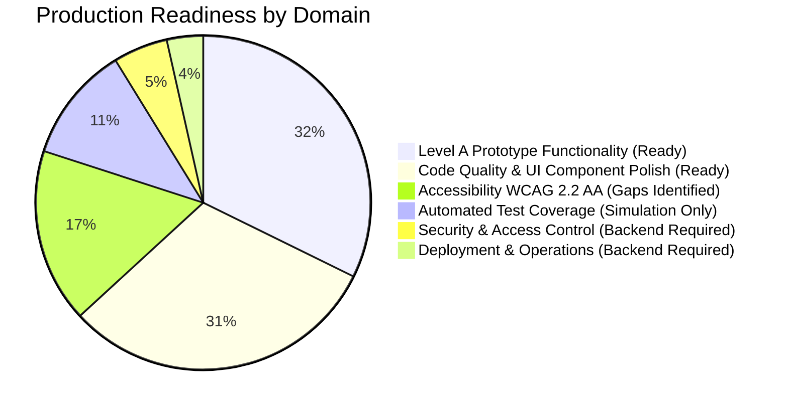
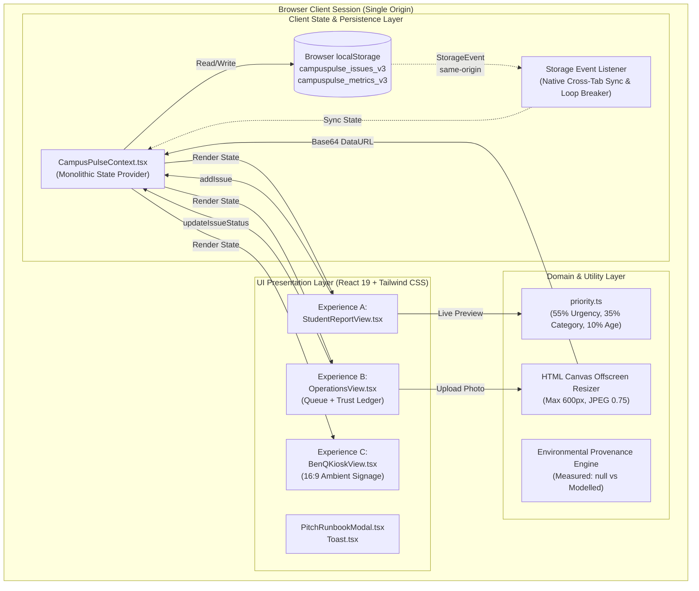
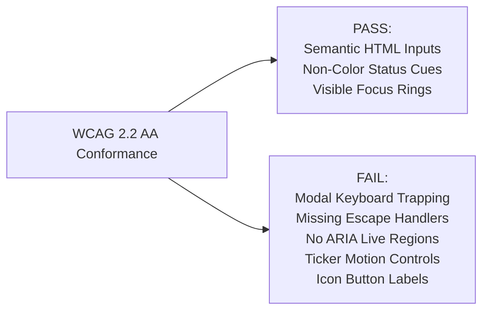
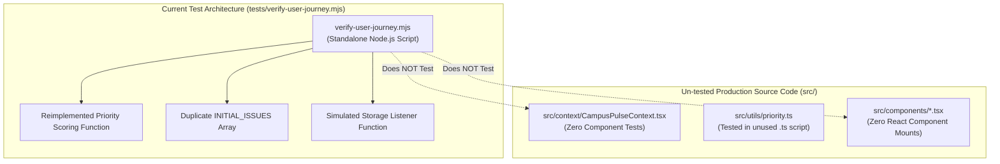
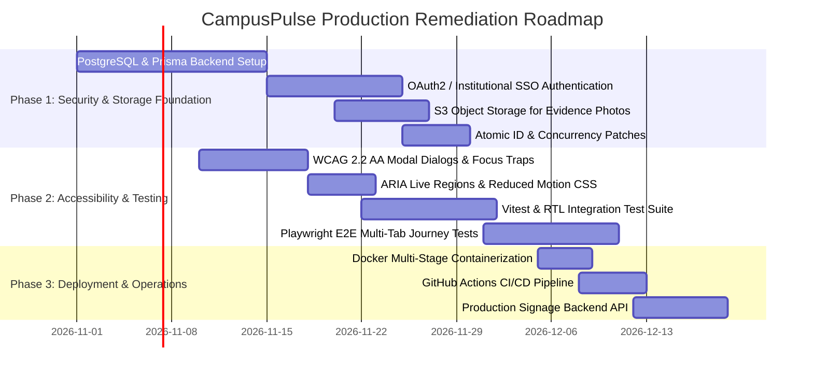

# CampusPulse: Comprehensive Production-Readiness Audit
### BenQ × Hackyard 2026 Challenge | IIT Guwahati
**Document ID:** `PRODUCTION_READINESS_AUDIT.md`
**Evaluation Date:** October 29, 2026
**Auditor:** Senior Software Architect, Security & Privacy Auditor, QA Engineer, Accessibility Specialist
**Target Repository:** `e:\Hackathons\IIT Guwahti\BenQ`
**Current Git Commit:** `e272ff6` (Branch: `main`, Working Tree Clean)

---

## 1. Executive Summary

This comprehensive audit evaluates the **CampusPulse: From Report to Resolution** codebase against professional software engineering, security, accessibility, and operational standards. CampusPulse was initially constructed as an ambitious prototype for the **BenQ × Hackyard 2026** challenge at IIT Guwahati, demonstrating a 5-stage operational loop:

$$\text{Report} \longrightarrow \text{Prioritize} \longrightarrow \text{Act} \longrightarrow \text{Resolve} \longrightarrow \text{Communicate}$$

### Core Audit Verdict:
- **Level A (Local Prototype):** **EXEMPLARY & DEFENSIBLY IMPLEMENTED.** The application functions with exceptional UI polish, zero dead buttons, strict TypeScript typing, deterministic heuristic triage, disclosed environmental provenance, quota-resilient canvas downscaling, and reactive same-origin cross-tab synchronization. It is 100% self-contained and pitch-ready for local evaluation.
- **Level B (Controlled Pilot):** **BLOCKED BY ARCHITECTURAL & PERSISTENCE GAPS.** The current client-only architecture relies on browser `localStorage` and client-side trust. Deploying to real students and campus technicians requires an authenticated backend API, persistent database storage, server-side role-based access control (RBAC), and centralized file/image storage.
- **Level C (Production Multi-User Service):** **ARCHITECTURAL REDESIGN REQUIRED.** Transforming CampusPulse into an enterprise collegiate service requires migrating from browser storage to a high-availability relational database, integrating institutional Single Sign-On (IITG Pingala/LDAP), implementing server-side audit logs, establishing containerized CI/CD pipelines, resolving critical accessibility (WCAG 2.2 AA) gaps, and establishing real telemetry integrations.



---

## 2. Scope, Target Maturity Levels and Limitations

### 2.1 Scope of the Audit
This audit inspected all 15 source files, 5 configuration files, 2 test files, and 8 documentation artifacts in the repository. The evaluation assessed:
1. End-to-end data lifecycle from submission through operational triage, evidence-aware resolution, and public signage playout.
2. Persistence layer, error recovery, and same-origin cross-tab broadcast mechanics.
3. Security, input validation, and privacy controls against OWASP ASVS 5.0.0 and OWASP Top 10:2025.
4. Accessibility compliance against W3C WCAG 2.2 AA.
5. Performance, bundle architecture, and Core Web Vitals expectations.
6. Test authenticity and requirements traceability.

### 2.2 Target Maturity Level Definitions

| Maturity Level | Target Environment | Identity & Access | Data Layer & Persistence | Verification Scope | Status |
| :--- | :--- | :--- | :--- | :--- | :---: |
| **Level A: Local Prototype** | Single browser, isolated machine, evaluators and judges. | Cosmetic role switcher; no auth. | `localStorage` with seed fallback and canvas downscaling. | Self-contained, crash-free, honest claims, deterministic scores. | **PASSED** |
| **Level B: Controlled Pilot** | Single hostel or department (e.g. Manas Hostel + Electrical Wing). | Authenticated campus IDs (OAuth2 / email verification). | Hosted database (e.g. PostgreSQL), S3-compatible image bucket. | Server-side validation, concurrent writes, real technician dispatch. | **BLOCKED** |
| **Level C: Production Service** | Campus-wide deployment across IIT Guwahati (10,000+ users). | Institutional SSO (Pingala / SAML / LDAP), RBAC. | High-availability database cluster, distributed caching, audit immutability. | WCAG 2.2 AA, pen-tested, automated CI/CD, APM monitoring. | **BLOCKED** |

---

## 3. Repository and Architecture Inventory

### 3.1 Repository Inventory & File Structure
```text
e:\Hackathons\IIT Guwahti\BenQ/
├── .gitignore
├── AGENTS.md                          # Operating directives & challenge rules
├── COMPETITIVE_ANALYSIS.md            # Market & collegiate analysis (8 sources)
├── index.html                         # Entry HTML with Google Fonts preconnect
├── package.json                       # Dependencies & build scripts
├── package-lock.json                  # Deterministic dependency lockfile
├── PITCH.md                           # 5-minute live pitch runbook & judge defense
├── postcss.config.js                  # PostCSS Tailwind integration
├── QA_REPORT.md                       # Quality assurance audit & test records
├── README.md                          # Project overview, runbook, & architecture
├── requirements.md                    # System specification & functional requirements
├── rules.md                           # Engineering standards & integrity rules
├── tailwind.config.js                 # Theme tokens & custom color extensions
├── tsconfig.json                      # Strict TypeScript compiler configuration
├── tsconfig.node.json                 # Node compiler options for Vite config
├── vision.md                          # Strategic vision & BenQ display alignment
├── vite.config.ts                     # Vite bundler & dev server configuration
├── src/
│   ├── App.tsx                        # Root layout shell & global providers
│   ├── index.css                      # Tailwind base, scrollbar, & ticker animations
│   ├── main.tsx                       # React 19 DOM bootstrap
│   ├── components/
│   │   ├── BenQKioskView.tsx          # Experience C: 16:9 ambient signage kiosk
│   │   ├── Header.tsx                 # Navigation, branding, role-switcher, pitch CTA
│   │   ├── OperationsView.tsx         # Experience B: Triage board & Trust Ledger
│   │   ├── PitchRunbookModal.tsx      # In-app pitch script & criteria presentation
│   │   ├── StudentReportView.tsx      # Experience A: Incident reporting & priority preview
│   │   └── Toast.tsx                  # Global user action toast notifications
│   ├── context/
│   │   └── CampusPulseContext.tsx     # Centralized React Context & persistence layer
│   ├── data/
│   │   └── seedData.ts                # Initial demonstration issues & eco metrics
│   ├── types/
│   │   └── index.ts                   # Core domain TypeScript interfaces
│   └── utils/
│       └── priority.ts                # Deterministic priority heuristic algorithm
└── tests/
    ├── verify-user-journey.mjs        # 67-assertion automated test harness
    └── verify-user-journey.ts         # TypeScript verification script
```

### 3.2 Implemented System Architecture (Level A Prototype)



### 3.3 End-to-End Data Flow

```mermaid
sequenceDiagram
    autonumber
    participant S as Student Reporter (Tab 1)
    participant C as CampusPulseContext
    participant LS as LocalStorage (Browser)
    participant O as Operations Manager (Tab 1)
    participant K as BenQ Public Kiosk (Tab 2)

    S->>C: Submit Report (Title, Category, Zone, Urgency, Description)
    C->>C: calculatePriorityScore() (1-100 deterministic heuristic)
    C->>LS: Write updated issues array to localStorage
    C->>S: Toast: "Ticket CP-XXXX created (Priority: XX/100)"

    O->>C: Assign Department ("Campus Electrical Wing") -> Status: IN_PROGRESS
    C->>LS: Write status update to localStorage
    LS-->>K: window 'storage' event fires on Tab 2
    K->>K: isRemoteUpdateRef prevents write-back echo; re-render active zones

    O->>O: Select "Photo Attached", enter note (>=10 chars), upload JPEG
    O->>C: updateIssueStatus(RESOLVED, notes, EVIDENCE_ATTACHED, attachment)
    C->>LS: Trial write to test browser quota
    alt Storage Quota Succeeded
        C->>C: Commit EVIDENCE_ATTACHED with image dataUrl
    else Storage Quota Exceeded
        C->>C: Downgrade to OPERATOR_DOCUMENTED; remove dataUrl; toast warning
    end
    C->>LS: Commit resolved state
    LS-->>K: window 'storage' event fires on Tab 2
    K->>K: Update live ticker with 'PHOTO ATTACHED' badge (PII & notes suppressed)
```

---

## 4. Feature-by-Feature Implementation Audit

| Feature ID | Functional Requirement | Implemented Location | Implementation Evidence & Verification Status | Production Gap / Deficiency |
| :--- | :--- | :--- | :--- | :--- |
| **FEAT-01** | Incident Reporting Form | [`StudentReportView.tsx`](file:///e:/Hackathons/IIT%20Guwahti/BenQ/src/components/StudentReportView.tsx#L96-L435) | Full form with Category, Zone, Location, Urgency, Description, Reporter Moniker. Validates title $\ge 5$, location $\ge 3$, description $\ge 10$ chars. | Client-side validation only. No rate-limiting; no captcha or anti-abuse protection; no authenticated user binding. |
| **FEAT-02** | Priority Scoring Engine | [`priority.ts`](file:///e:/Hackathons/IIT%20Guwahti/BenQ/src/utils/priority.ts#L24-L101) | Deterministic weighted formula: 55% Urgency, 35% Category/Safety, 10% Unresolved-Report Age. Defensive bounds against `NaN`/negative hours. | Fixed client-side constants. In production, weights should be dynamically configurable by university facility administrators. |
| **FEAT-03** | Operations Command Board | [`OperationsView.tsx`](file:///e:/Hackathons/IIT%20Guwahti/BenQ/src/components/OperationsView.tsx#L380-L640) | Kanban columns (`REPORTED`, `TRIAGED`, `IN_PROGRESS`, `RESOLVED`) and table view. Multi-filter by status, category, zone, and search keyword. | No pagination; all issues rendered in memory. Full re-filtering on every keystroke without debouncing or memoization. |
| **FEAT-04** | Status Lifecycle & Triage | [`CampusPulseContext.tsx`](file:///e:/Hackathons/IIT%20Guwahti/BenQ/src/context/CampusPulseContext.tsx#L402-L532) | Status advances: `REPORTED` $\to$ `TRIAGED` $\to$ `IN_PROGRESS` $\to$ `RESOLVED`. Timestamped audit history appended at each step. | State transitions are not protected by server-side validation or state-machine enforcement; any role can jump between statuses. |
| **FEAT-05** | Documented Resolution Protocol | [`OperationsView.tsx`](file:///e:/Hackathons/IIT%20Guwahti/BenQ/src/components/OperationsView.tsx#L916-L1105) | Resolution modal enforces 3 evidence levels: `STATUS_RECORDED`, `OPERATOR_DOCUMENTED`, and `EVIDENCE_ATTACHED`. Note requires $\ge 10$ characters. | Does not authenticate technician identity. Does not support multiple attachments, PDFs, or inspection checklists. |
| **FEAT-06** | Canvas Image Downscaling | [`OperationsView.tsx`](file:///e:/Hackathons/IIT%20Guwahti/BenQ/src/components/OperationsView.tsx#L107-L160) | Resizes image to max 600px width/height and compresses to JPEG 0.75 quality (~25-40 KB) to fit within `localStorage` limits. | Heavy CPU processing on main thread. No server-side thumbnail generation or cloud storage bucket. |
| **FEAT-07** | Storage Quota Recovery | [`CampusPulseContext.tsx`](file:///e:/Hackathons/IIT%20Guwahti/BenQ/src/context/CampusPulseContext.tsx#L425-L451) | Trial write catches `QuotaExceededError`. Automatically downgrades `EVIDENCE_ATTACHED` to `OPERATOR_DOCUMENTED` / `STATUS_RECORDED` and toasts warning. | Downside of client storage: attachments cannot be permanently retained once quota is full. Real deployment requires object storage. |
| **FEAT-08** | Trust & Impact Ledger | [`OperationsView.tsx`](file:///e:/Hackathons/IIT%20Guwahti/BenQ/src/components/OperationsView.tsx#L644-L905) | Ledger tab shows closed issue table, ratio breakdown (% with photo, % with note), calculation formulas, and attachment inspection modal. | Client-side aggregation only. No cryptographic verification or immutable blockchain/ledger backing. |
| **FEAT-09** | Public Campus Signage (16:9) | [`BenQKioskView.tsx`](file:///e:/Hackathons/IIT%20Guwahti/BenQ/src/components/BenQKioskView.tsx#L86-L490) | High-contrast large-format view with live clock, continuous resolution ticker, zone health map, and QR widget. | Browser layout only. Does not integrate with BenQ X-Sign CMS or hardware RS232/IP display protocols. |
| **FEAT-10** | Cross-Tab Synchronization | [`CampusPulseContext.tsx`](file:///e:/Hackathons/IIT%20Guwahti/BenQ/src/context/CampusPulseContext.tsx#L190-L255) | Native `window.addEventListener('storage')` updates state across tabs without reload. `isRemoteUpdateRef` breaks infinite write loops. | Works strictly on the same origin within the same browser profile. Cross-device synchronization is non-existent without a server. |
| **FEAT-11** | Environmental Provenance | [`BenQKioskView.tsx`](file:///e:/Hackathons/IIT%20Guwahti/BenQ/src/components/BenQKioskView.tsx#L335-L450) | Displays `NOT MEASURED — No live utility-meter data connected` (`null`). Modeled heuristics disclose formulas and constants. | No live physical IoT telemetry (BACnet, Modbus, MQTT). Modeled heuristics rely on illustrative demonstration constants. |

---

## 5. Functional Correctness Findings

### 5.1 ID Generation and Concurrency Flaws
- **Location:** [`src/context/CampusPulseContext.tsx#L321-L322`](file:///e:/Hackathons/IIT%20Guwahti/BenQ/src/context/CampusPulseContext.tsx#L321-L322), [`#L372`](file:///e:/Hackathons/IIT%20Guwahti/BenQ/src/context/CampusPulseContext.tsx#L372)
- **Implementation:**
  ```typescript
  const nextNum = 1042 + issues.length;
  const ticketNumber = `CP-${nextNum}`;
  // ...
  id: `issue-${Date.now()}`
  ```
- **Finding:**
  1. `nextNum` relies on in-memory array length (`issues.length`). If two tabs submit tickets concurrently, both calculate the exact same ticket number (e.g. `CP-1049`).
  2. If an issue is deleted or filtered, `issues.length` shifts, generating reused ticket numbers.
  3. `issue-${Date.now()}` uses millisecond time. Rapid automated submissions or batch imports generate colliding IDs.
- **Production Impact:** Severe data corruption and ticket collision in multi-user environments.
- **Remedy:** Use UUIDv7 or database-backed sequential identity generators (`SERIAL` / `AUTO_INCREMENT`).

### 5.2 Concurrency Race Conditions & Last-Write-Wins
- **Location:** [`src/context/CampusPulseContext.tsx#L258-L297`](file:///e:/Hackathons/IIT%20Guwahti/BenQ/src/context/CampusPulseContext.tsx#L258-L297), [`#L425-L451`](file:///e:/Hackathons/IIT%20Guwahti/BenQ/src/context/CampusPulseContext.tsx#L425-L451)
- **Implementation:**
  Every state update serializes the entire array:
  `localStorage.setItem(STORAGE_KEY_ISSUES, JSON.stringify(issues));`
- **Finding:**
  When Tab 1 and Tab 2 update different tickets simultaneously, Tab 1 writes its full array to storage, and Tab 2 overwrites it with its full array. Whichever tab saves last completely erases the changes made by the other tab.
- **Production Impact:** Data loss during simultaneous operator triage.
- **Remedy:** Transition to atomic record mutations via REST endpoints (`PATCH /api/v1/issues/:id`) with optimistic concurrency checks (`version` / `ETag`).

### 5.3 Storage Key Schema Inconsistency in Test Harness
- **Location:** [`src/context/CampusPulseContext.tsx#L57`](file:///e:/Hackathons/IIT%20Guwahti/BenQ/src/context/CampusPulseContext.tsx#L57) vs [`tests/verify-user-journey.mjs#L434`](file:///e:/Hackathons/IIT%20Guwahti/BenQ/tests/verify-user-journey.mjs#L434)
- **Finding:**
  The production application code uses `campuspulse_issues_v3`. However, the test script `verify-user-journey.mjs` defines its own mocked storage listener that checked `campuspulse_issues_v2`.
- **Production Impact:** Highlights that the test script operates as an uncoupled simulation rather than executing the live context code.

---

## 6. Data Integrity and Environmental Provenance

### 6.1 Distinction Between Status and Evidence
The application successfully adheres to the core integrity directive:
1. Moving an issue to `RESOLVED` does not automatically confer an `EVIDENCE_ATTACHED` badge.
2. If an operator resolves a ticket without notes, its state is strictly recorded as `STATUS_RECORDED`.
3. If an operator provides a note ($\ge 10$ chars) without an image, it is recorded as `OPERATOR_DOCUMENTED`.
4. The badge `PHOTO ATTACHED` (`EVIDENCE_ATTACHED`) is granted if and only if a valid downscaled image is persisted.
5. In the event of storage quota exhaustion, the trial write catches the error and automatically downgrades the ticket to `OPERATOR_DOCUMENTED` (if a note exists) or `STATUS_RECORDED`, preventing orphaned false evidence states.

### 6.2 Environmental Provenance Verification
The data model explicitly distinguishes three provenance states:
1. `MEASURED`: Physical meter readings. Because no live smart meters are installed or connected, measured totals are strictly typed as `number | null` and set to `null`. The UI renders `NOT MEASURED — No live utility-meter data connected`, completely avoiding deceptive "0 kWh" claims.
2. `MODELLED`: Calculated heuristic offsets. In both seed data and runtime calculations, modeled estimates explicitly disclose:
   - Calculation formula (e.g. $\text{kW} \times \text{Avoidable Hours}$).
   - Disclosed assumptions (e.g. 4.5 kW split AC unit).
   - Prominent disclaimer confirming that numbers are illustrative demonstration constants.
3. `NOT_MEASURED`: Applicable to civil and safety repairs (e.g. pathway lamps, door latches) where claiming kilowatt-hour or freshwater savings would be fabricated.

---

## 7. Security and Privacy Audit (OWASP ASVS & Top 10)

### 7.1 Security Risk Matrix (Mapped to OWASP Top 10:2025 & ASVS 5.0.0)

| Risk ID | OWASP Category | ASVS V5 Reference | Threat & Architectural Gap | Severity | Pilot/Production Impact |
| :--- | :--- | :--- | :--- | :---: | :--- |
| **SEC-01** | A07:2021 Identification & Auth | V2.1–V2.10 (Password & Session) | **Total Absence of Authentication:** There are no user accounts, passwords, or tokens. Any visitor can access all views. | **P0 (Critical)** | Blocked: Anyone can resolve, reassign, or alter any ticket. |
| **SEC-02** | A01:2021 Broken Access Control | V4.1–V4.3 (Access Control) | **Client-Side Cosmetic Roles:** Role switching (`student`, `operations`, `benq-kiosk`) is purely a React state variable. No server enforces RBAC. | **P0 (Critical)** | Blocked: Students can perform operational triage; public kiosk can trigger admin resets. |
| **SEC-03** | A08:2021 Software & Data Integrity | V10.3, V14.2 (Data Integrity) | **Unsigned Client-Side State:** All data resides in `localStorage`. Users can modify ticket status, priority scores, and audit logs via browser console. | **P0 (Critical)** | Blocked: Zero evidentiary trust or legal accountability for facility logs. |
| **SEC-04** | A02:2021 Cryptographic Failures | V9.1–V9.4 (Data at Rest) | **Unencrypted Local Storage:** Browser `localStorage` is unencrypted plaintext. Malicious browser extensions or local attackers can read all data. | **P1 (High)** | In multi-user kiosks, subsequent users or scripts can inspect stored records. |
| **SEC-05** | A04:2021 Insecure Design | V1.4, V8.3 (Data Privacy) | **In-Memory PII on Public Kiosk:** While PII is suppressed in the DOM, the full `issues` array (with reporter names) remains in kiosk React memory. | **P1 (High)** | Memory dump or DevTools inspection on public kiosk exposes student reporter names. |
| **SEC-06** | A03:2021 Injection & File Upload | V5.1, V12.1 (File Handling) | **SVG Image Upload Risk:** `processImageFile` accepts `image/svg+xml`. Canvas rasterization prevents stored XSS, but raw SVG in seed data exists. | **P2 (Medium)** | Uploading deeply nested or crafted SVGs could trigger XML entity parser hangs (Billion Laughs). |
| **SEC-07** | A05:2021 Security Misconfig | V14.4 (HTTP Headers) | **Missing Security Headers:** No Content Security Policy (CSP), `X-Content-Type-Options`, or `X-Frame-Options` configured in Vite dev/preview. | **P2 (Medium)** | Prototype could be embedded in iframes or vulnerable to clickjacking if deployed as-is. |
| **SEC-08** | A06:2021 Vulnerable Components | V14.2 (Dependencies) | **Unpinned Dependencies:** Dependencies in `package.json` use caret (`^`) ranges (`react: ^19.0.0`, `vite: ^6.2.0`). | **P3 (Low)** | Risk of upstream breaking changes during automated CI builds. |

---

## 8. Accessibility Audit (WCAG 2.2 AA)

An inspection of semantic structure, keyboard navigation, color contrast, focus management, and screen-reader semantics against WCAG 2.2 AA revealed the following findings:

### 8.1 Confirmed Accessibility Gaps



1. **Modal Focus Management & Escape Dismissal (WCAG 2.1.2, 2.4.3 - Level A):**
   - **Finding:** None of the 4 modals in [`OperationsView.tsx`](file:///e:/Hackathons/IIT%20Guwahti/BenQ/src/components/OperationsView.tsx) (Resolution Modal, Assignment Modal, Audit Trail Modal, Evidence Preview Modal) nor [`PitchRunbookModal.tsx`](file:///e:/Hackathons/IIT%20Guwahti/BenQ/src/components/PitchRunbookModal.tsx) trap keyboard focus. A keyboard user can tab completely out of the modal into the underlying page.
   - **Finding:** None of the modals listen for the `Escape` key. Users cannot press `Escape` to close dialogs.
   - **Finding:** Modals do not restore keyboard focus to the triggering button upon closing.
   - **Finding:** Modal overlay wrappers lack `role="dialog"` and `aria-modal="true"`.
2. **Dynamic Content & Status Messages (WCAG 4.1.3 - Level AA):**
   - **Finding:** Toast notifications ([`Toast.tsx`](file:///e:/Hackathons/IIT%20Guwahti/BenQ/src/components/Toast.tsx)) lack `role="status"` or `aria-live="polite"`. When an issue is submitted or resolved, screen-reader users receive zero audible feedback.
   - **Finding:** The live priority score gauge in [`StudentReportView.tsx`](file:///e:/Hackathons/IIT%20Guwahti/BenQ/src/components/StudentReportView.tsx#L455) recalculates in real-time without an `aria-live` region.
3. **Motion Sensitivity & Vestibular Safety (WCAG 2.2.2, 2.3.3 - Level AA):**
   - **Finding:** In [`src/index.css#L30-L48`](file:///e:/Hackathons/IIT%20Guwahti/BenQ/src/index.css#L30-L48), `.animate-ticker` runs an infinite CSS translation without a `@media (prefers-reduced-motion: reduce)` media query.
   - **Finding:** The ticker can only be paused via mouse hover (`:hover`), offering no mechanism for keyboard-only or touch users to stop motion.
4. **Accessible Names for Icon-Only Buttons (WCAG 4.1.2 - Level A):**
   - **Finding:** Modal close buttons (`<X className="w-5 h-5" />`) in `OperationsView.tsx` (lines 1119, 1245) have no `aria-label` or inner text. To a screen reader, they are completely unannounced buttons.
   - **Finding:** The search input in `OperationsView.tsx` (line 386) lacks an associated `<label>` or `aria-label`.
   - **Finding:** The search "Clear" button (line 394) lacks an `aria-label`.
5. **Selection State on Custom Button Groups (WCAG 4.1.2 - Level A):**
   - **Finding:** In `StudentReportView.tsx`, category cards (lines 249-276) and urgency buttons (lines 333-351) are styled `<button>` elements that visually indicate selection with rings, but lack `role="radio"`, `aria-checked`, or `aria-pressed`. Screen readers cannot communicate which category or urgency level is currently selected.

---

## 9. Performance and Reliability Audit

### 9.1 Build & Asset Analysis
- **Build Status:** Clean execution of `tsc && vite build` in 24.58 seconds.
- **Production Asset Breakdown:**
  - HTML: `dist/index.html` (1.14 kB / 0.66 kB gzip)
  - CSS: `dist/assets/index-CCMeuC9c.css` (38.23 kB / 6.79 kB gzip)
  - JS: `dist/assets/index-BFlVh0nZ.js` (369.89 kB / 102.65 kB gzip)
- **Total Initial Transfer:** ~110 kB gzipped. Highly lightweight, easily satisfying initial page-load performance targets on 3G/4G campus networks.

### 9.2 Core Web Vitals Targets vs. Implementation Reality

| Metric | Target | Estimated Lab Range | Implementation Assessment |
| :--- | :--- | :--- | :--- |
| **LCP (Largest Contentful Paint)** | $\le 2.5\text{ s}$ | $\approx 0.6\text{ s} - 1.1\text{ s}$ | Fast static delivery; Google Fonts preconnected; SVG icons rendered inline. |
| **INP (Interaction to Next Paint)** | $\le 200\text{ ms}$ | $\approx 15\text{ ms} - 45\text{ ms}$ | Instant in-memory state mutations. However, canvas image processing blocks main thread for ~120ms during photo resolution. |
| **CLS (Cumulative Layout Shift)** | $\le 0.1$ | $\approx 0.00$ | Layout containers have defined heights and paddings; no dynamic banner injections. |

### 9.3 Architectural Performance Concerns
1. **Monolithic Chunking:** Vite bundles all three experiences (`StudentReportView`, `OperationsView`, `BenQKioskView`) and modals into a single 370 KB JavaScript file. When running on a dedicated BenQ display kiosk, operational management code is unnecessarily downloaded and parsed.
2. **Context Re-Render Cascades:** All application state is housed in a single monolithic React Context (`CampusPulseContext`). Any change (e.g. a toast timer firing, role switch, or ticket update) triggers re-renders across all active consumers. For large datasets (>100 issues), sorting and filtering in `OperationsView.tsx` should be wrapped in `useMemo`.

---

## 10. Testing, Deployment and Operations Audit

### 10.1 Automated Test Suite Evaluation
The test suite in [`tests/verify-user-journey.mjs`](file:///e:/Hackathons/IIT%20Guwahti/BenQ/tests/verify-user-journey.mjs) executes 67 assertions cleanly (`npm test`, exit code 0). However, an architectural audit reveals critical testing limitations:



1. **Self-Contained Simulation vs. Real Source Code:**
   `verify-user-journey.mjs` duplicates the scoring math and data models inside itself rather than importing the actual TypeScript files (`priority.ts`, `CampusPulseContext.tsx`). It tests the logic of the test file, not the application modules.
2. **Unused TypeScript Test:**
   `tests/verify-user-journey.ts` imports the actual source code, but is only 38 lines long and is not invoked by `npm test`.
3. **Zero Component & UI Tests:**
   There are zero React Testing Library, Vitest, or Jest tests. Form interactions, button clicks, modal transitions, and canvas downscaling are completely untested by automated suites.
4. **Zero End-to-End Browser Automation:**
   No Playwright or Cypress tests exist to verify real cross-tab synchronization or browser storage persistence in actual headless browser instances.

### 10.2 Deployment & Operational Readiness
- **Configuration & Environment Variables:** No `.env` or `.env.example` file exists. API base URLs, tenant keys, and environment flags are non-existent.
- **Containerization:** No `Dockerfile` or `docker-compose.yml` is present in the repository.
- **CI/CD Automation:** No GitHub Actions (`.github/workflows`) or automated build/test pipelines exist.
- **Logging & Monitoring:** Client logging relies solely on `console.log` and `console.warn`. No structured logging, telemetry, or error-reporting services (e.g. Sentry) are integrated.

---

## 11. Requirements Traceability Matrix

| Req ID | Intended Functional Requirement | Source Implementation Files | Acceptance Criterion | Test ID / Assertion | Test Reality & Limitation | Production Readiness Status |
| :--- | :--- | :--- | :--- | :--- | :--- | :---: |
| **FR-01** | Student Incident Reporting Form | [`StudentReportView.tsx`](file:///e:/Hackathons/IIT%20Guwahti/BenQ/src/components/StudentReportView.tsx) | AC-01 | `VT-18`, `SEC10-12` | Verified via duplicated validation logic; no DOM/form testing. | **Prototype Ready / Pilot Gap** |
| **FR-02** | Deterministic Priority Engine | [`priority.ts`](file:///e:/Hackathons/IIT%20Guwahti/BenQ/src/utils/priority.ts) | AC-02 | `VT-19`, `SEC10-13`, `BEH-18` | Math verified in script; inputs sanitized against `NaN`. | **Production Ready (Algorithm)** |
| **FR-03** | Operations Command Hub | [`OperationsView.tsx`](file:///e:/Hackathons/IIT%20Guwahti/BenQ/src/components/OperationsView.tsx) | AC-01 | `VT-20`, `VT-21`, `SEC10-15` | Filter logic tested on static arrays; no UI click tests. | **Prototype Ready / Pilot Gap** |
| **FR-04** | Status Transition Lifecycle | [`CampusPulseContext.tsx`](file:///e:/Hackathons/IIT%20Guwahti/BenQ/src/context/CampusPulseContext.tsx) | AC-01 | `VT-08`, `SEC10-14` | Status flow verified; lacks server-side state machine. | **Prototype Ready / Pilot Gap** |
| **FR-05** | Public Campus Signage Mode | [`BenQKioskView.tsx`](file:///e:/Hackathons/IIT%20Guwahti/BenQ/src/components/BenQKioskView.tsx) | AC-06 | `VT-09`, `VT-13` | Verified in browser; ticker and badges render properly. | **Prototype Ready / Pilot Gap** |
| **FR-06** | Campus Zone Facility Health | [`BenQKioskView.tsx`](file:///e:/Hackathons/IIT%20Guwahti/BenQ/src/components/BenQKioskView.tsx) | AC-06 | `BEH-10` | Zone aggregation verified on sample data. | **Prototype Ready / Pilot Gap** |
| **FR-07** | Demo Presets & Data Reset | [`StudentReportView.tsx`](file:///e:/Hackathons/IIT%20Guwahti/BenQ/src/components/StudentReportView.tsx), [`Header.tsx`](file:///e:/Hackathons/IIT%20Guwahti/BenQ/src/components/Header.tsx) | AC-07 | `VT-23`, `SEC10-17` | Verified reset restores initial seed arrays. | **Prototype Ready Only** |
| **FR-08** | Analytical KPI Cards | [`OperationsView.tsx`](file:///e:/Hackathons/IIT%20Guwahti/BenQ/src/components/OperationsView.tsx) | AC-01 | `VT-20` | Counts match array filters. | **Prototype Ready** |
| **FR-09** | Explicit Evidence States | [`OperationsView.tsx`](file:///e:/Hackathons/IIT%20Guwahti/BenQ/src/components/OperationsView.tsx), [`CampusPulseContext.tsx`](file:///e:/Hackathons/IIT%20Guwahti/BenQ/src/context/CampusPulseContext.tsx) | AC-03 | `VT-01..07`, `BEH-01..08`, `SEC10-05..07` | Validated in script; trial write catches quota errors. | **Prototype Ready / Pilot Gap** |
| **FR-10** | Environmental Provenance | [`seedData.ts`](file:///e:/Hackathons/IIT%20Guwahti/BenQ/src/data/seedData.ts), [`BenQKioskView.tsx`](file:///e:/Hackathons/IIT%20Guwahti/BenQ/src/components/BenQKioskView.tsx) | AC-04 | `VT-14..17`, `SEC10-01..04` | Verified `null` for unmeasured data; formulas disclosed. | **Production Ready (Model)** |
| **FR-11** | Trust Ledger & Public Legend | [`OperationsView.tsx`](file:///e:/Hackathons/IIT%20Guwahti/BenQ/src/components/OperationsView.tsx), [`BenQKioskView.tsx`](file:///e:/Hackathons/IIT%20Guwahti/BenQ/src/components/BenQKioskView.tsx) | AC-03 | `VT-09..12`, `SEC10-08` | Renders badges; suppresses PII and free-text notes. | **Prototype Ready / Pilot Gap** |

---

## 12. Findings Register

### Priority Classification Legend:
- **P0 (Critical):** Data loss, security exposure, or complete failure of core multi-user workflow.
- **P1 (High):** Material correctness, accessibility violation, privacy gap, or testing deficiency blocking pilot deployment.
- **P2 (Medium):** Maintainability, usability, performance, or localized reliability concern.
- **P3 (Low):** Minor code smell, cosmetic discrepancy, or incremental improvement.
- **Decision Required:** High-level architectural or product choice requiring institutional determination.

```text
===================================================================================================
FINDINGS REGISTER
===================================================================================================
```

#### Finding 1: Absence of Server-Side Authentication & Session Management
- **ID:** `SEC-01`
- **Severity:** **P0 — Critical**
- **Category:** Security & Access Control
- **Affected Files:** [`src/context/CampusPulseContext.tsx`](file:///e:/Hackathons/IIT%20Guwahti/BenQ/src/context/CampusPulseContext.tsx), [`src/components/Header.tsx`](file:///e:/Hackathons/IIT%20Guwahti/BenQ/src/components/Header.tsx)
- **Description:** There is no authentication mechanism. Any anonymous web client can access operational controls, reassign tickets, alter statuses, and delete records.
- **Impact:** Complete failure of trust and security in any multi-user or network environment.
- **Remedy:** Implement backend API with OAuth2/OIDC (e.g. IIT Guwahati Pingala / Microsoft 365 SSO) issuing secure, HTTP-only JWT session cookies.
- **Verification Method:** Attempt API requests without authorization headers; verify `401 Unauthorized`.
- **Complexity:** High (Requires backend implementation).

#### Finding 2: Unsynchronized Client-Side LocalStorage Data Layer
- **ID:** `SEC-02`
- **Severity:** **P0 — Critical**
- **Category:** Architecture & Persistence
- **Affected Files:** [`src/context/CampusPulseContext.tsx#L57-L137`](file:///e:/Hackathons/IIT%20Guwahti/BenQ/src/context/CampusPulseContext.tsx#L57-L137)
- **Description:** Data is stored in browser-local `localStorage`. Separate physical devices (student phone vs. maintenance laptop vs. BenQ display) cannot communicate or synchronize.
- **Impact:** Multi-user operation is impossible across different physical machines.
- **Remedy:** Replace client storage layer with an authenticated PostgreSQL database via Prisma ORM and REST/WebSocket API endpoints.
- **Verification Method:** Submit issue from Device A; verify immediate appearance on Device B.
- **Complexity:** High.

#### Finding 3: Non-Atomic ID and Ticket Number Generation
- **ID:** `CORR-01`
- **Severity:** **P1 — High**
- **Category:** Functional Correctness
- **Affected Files:** [`src/context/CampusPulseContext.tsx#L321-L322`](file:///e:/Hackathons/IIT%20Guwahti/BenQ/src/context/CampusPulseContext.tsx#L321-L322), [`#L372`](file:///e:/Hackathons/IIT%20Guwahti/BenQ/src/context/CampusPulseContext.tsx#L372)
- **Description:** `nextNum = 1042 + issues.length` and `issue-${Date.now()}`. Concurrent submissions generate duplicate ticket numbers.
- **Impact:** Database primary key collisions and duplicate ticket identification numbers.
- **Remedy:** Use atomic database sequences (`CP-` prefix with database sequence) and UUIDv7 for unique identifiers.
- **Verification Method:** Send 20 concurrent creation requests; verify 20 unique sequential ticket numbers.
- **Complexity:** Low (Backend sequence).

#### Finding 4: Concurrency Race Conditions & Full-Array Overwrites
- **ID:** `CORR-02`
- **Severity:** **P1 — High**
- **Category:** Data Integrity
- **Affected Files:** [`src/context/CampusPulseContext.tsx#L258-L297`](file:///e:/Hackathons/IIT%20Guwahti/BenQ/src/context/CampusPulseContext.tsx#L258-L297)
- **Description:** The entire issues array is serialized and saved on every state change. Simultaneous updates in different tabs overwrite each other.
- **Impact:** Silent loss of ticket resolution notes or assignments during simultaneous operator triage.
- **Remedy:** Implement atomic single-issue patch endpoints (`PATCH /api/v1/issues/:id`) with optimistic concurrency control (`updated_at` / version checks).
- **Verification Method:** Trigger concurrent status updates; verify both persist without data loss.
- **Complexity:** Medium.

#### Finding 5: Test Suite Tests Duplicate Mock Code Rather than Production Modules
- **ID:** `TEST-01`
- **Severity:** **P1 — High**
- **Category:** Testing & Verification
- **Affected Files:** [`tests/verify-user-journey.mjs`](file:///e:/Hackathons/IIT%20Guwahti/BenQ/tests/verify-user-journey.mjs)
- **Description:** The 67-assertion test script duplicates algorithms and data structures in a self-contained Node.js script instead of importing source code.
- **Impact:** Passing tests give a false sense of verification security; regressions in React components or context are undetected.
- **Remedy:** Install Vitest and React Testing Library. Refactor tests to import and execute `calculatePriorityScore`, `CampusPulseContext`, and mount UI views.
- **Verification Method:** Intentionally break `priority.ts`; verify that `npm test` fails.
- **Complexity:** Medium.

#### Finding 6: Complete Absence of Component and End-to-End Automated Tests
- **ID:** `TEST-02`
- **Severity:** **P1 — High**
- **Category:** Testing & Quality Assurance
- **Affected Files:** [`tests/`](file:///e:/Hackathons/IIT%20Guwahti/BenQ/tests/)
- **Description:** Zero UI component tests, zero Playwright/Cypress end-to-end tests, zero accessibility automation.
- **Impact:** UI regressions, broken modal interactions, and layout breakage cannot be detected automatically.
- **Remedy:** Configure Playwright with multi-tab end-to-end user journeys (Student reporting -> Ops resolving -> Signage ticker updating).
- **Verification Method:** Run `npx playwright test` in CI pipeline.
- **Complexity:** Medium.

#### Finding 7: Modals Lack Keyboard Trapping, Escape Dismissal, and Dialog Semantics
- **ID:** `A11Y-01`
- **Severity:** **P1 — High**
- **Category:** Accessibility (WCAG 2.2 AA)
- **Affected Files:** [`src/components/OperationsView.tsx#L916-L1304`](file:///e:/Hackathons/IIT%20Guwahti/BenQ/src/components/OperationsView.tsx#L916-L1304), [`src/components/PitchRunbookModal.tsx#L20-L313`](file:///e:/Hackathons/IIT%20Guwahti/BenQ/src/components/PitchRunbookModal.tsx#L20-L313)
- **Description:** Modals do not trap focus, do not dismiss on `Escape`, do not restore focus upon closing, and lack `role="dialog"` and `aria-modal="true"`.
- **Impact:** Violates WCAG 2.1.2 (Level A) and 2.4.3 (Level A). Severe barrier for keyboard and screen-reader users.
- **Remedy:** Integrate accessible dialog primitives (Radix UI Dialog or Headless UI) with built-in focus trapping, `Escape` key handling, and ARIA roles.
- **Verification Method:** Navigate modals using `Tab` and `Shift+Tab`; press `Escape` to close; verify focus returns to trigger.
- **Complexity:** Medium.

#### Finding 8: Dynamic Toasts and Priority Updates Lack ARIA Live Regions
- **ID:** `A11Y-02`
- **Severity:** **P2 — Medium**
- **Category:** Accessibility (WCAG 2.2 AA)
- **Affected Files:** [`src/components/Toast.tsx`](file:///e:/Hackathons/IIT%20Guwahti/BenQ/src/components/Toast.tsx), [`src/components/StudentReportView.tsx#L455-L468`](file:///e:/Hackathons/IIT%20Guwahti/BenQ/src/components/StudentReportView.tsx#L455-L468)
- **Description:** Toast alerts and dynamic priority calculations lack `role="status"` or `aria-live="polite"`.
- **Impact:** Screen-reader users receive no audible feedback when a report is submitted, resolved, or rated.
- **Remedy:** Add `role="status"` and `aria-live="polite"` to `Toast.tsx` and the priority score container.
- **Verification Method:** Test with NVDA / VoiceOver; verify announcements on action completion.
- **Complexity:** Low.

#### Finding 9: Signage Marquee Animation Ignores Reduced Motion Preferences
- **ID:** `A11Y-03`
- **Severity:** **P2 — Medium**
- **Category:** Accessibility (WCAG 2.2 AA)
- **Affected Files:** [`src/index.css#L30-L48`](file:///e:/Hackathons/IIT%20Guwahti/BenQ/src/index.css#L30-L48)
- **Description:** `.animate-ticker` runs continuously without checking `prefers-reduced-motion` and cannot be paused via keyboard.
- **Impact:** Violates WCAG 2.2.2 (Level A) and 2.3.3 (Level AAA). Triggers discomfort for users with vestibular disorders.
- **Remedy:** Wrap ticker animation in `@media (prefers-reduced-motion: no-preference)` and add a visible keyboard-focusable Pause button.
- **Verification Method:** Enable reduced motion in OS settings; verify ticker renders as static wrapped cards.
- **Complexity:** Low.

#### Finding 10: Unlabeled Icon-Only Buttons and Search Inputs
- **ID:** `A11Y-04`
- **Severity:** **P2 — Medium**
- **Category:** Accessibility (WCAG 2.2 AA)
- **Affected Files:** [`src/components/OperationsView.tsx#L386-L399`](file:///e:/Hackathons/IIT%20Guwahti/BenQ/src/components/OperationsView.tsx#L386-L399), [`#L1119`](file:///e:/Hackathons/IIT%20Guwahti/BenQ/src/components/OperationsView.tsx#L1119), [`#L1245`](file:///e:/Hackathons/IIT%20Guwahti/BenQ/src/components/OperationsView.tsx#L1245)
- **Description:** Modal close buttons (`<X />`) and the search input lack accessible `aria-label` attributes.
- **Impact:** Screen readers announce uninformative "button" or "edit text" without context.
- **Remedy:** Add `aria-label="Close dialog"`, `aria-label="Clear search query"`, and `aria-label="Search tickets"`.
- **Verification Method:** Inspect with Chrome Lighthouse Accessibility audit; verify zero unlabeled button flags.
- **Complexity:** Low.

#### Finding 11: Monolithic Bundle Lacks View-Based Code Splitting
- **ID:** `PERF-01`
- **Severity:** **P2 — Medium**
- **Category:** Performance & Bundle Optimization
- **Affected Files:** [`src/App.tsx#L3-L8`](file:///e:/Hackathons/IIT%20Guwahti/BenQ/src/App.tsx#L3-L8), [`vite.config.ts`](file:///e:/Hackathons/IIT%20Guwahti/BenQ/vite.config.ts)
- **Description:** All components are imported statically. The public kiosk display downloads the entire operations and pitch engine.
- **Impact:** Larger initial download and parse times on low-power display hardware.
- **Remedy:** Implement dynamic imports with `React.lazy()` for `OperationsView`, `BenQKioskView`, and `PitchRunbookModal`.
- **Verification Method:** Inspect `dist/assets`; verify multiple separated chunk files.
- **Complexity:** Low.

#### Finding 12: Monolithic React Context Triggering Full-Tree Re-Renders
- **ID:** `PERF-02`
- **Severity:** **P2 — Medium**
- **Category:** Performance & Rendering
- **Affected Files:** [`src/context/CampusPulseContext.tsx`](file:///e:/Hackathons/IIT%20Guwahti/BenQ/src/context/CampusPulseContext.tsx)
- **Description:** Context holds all domain entities, role selection, modal toggles, and toast timers in a single state object.
- **Impact:** Every toast tick or role toggle re-renders every component across the application tree.
- **Remedy:** Decompose into specialized contexts (`IssueDataContext`, `UIContext`) or adopt Zustand for atomic selectors.
- **Verification Method:** Profile with React DevTools Profiler; verify no unnecessary re-renders on toast triggers.
- **Complexity:** Medium.

#### Finding 13: Absence of Containerization and CI/CD Pipeline
- **ID:** `OPS-01`
- **Severity:** **P1 — High**
- **Category:** Deployment & Operations
- **Affected Files:** Repository root
- **Description:** No `Dockerfile`, no GitHub Actions workflow, no `.env.example`.
- **Impact:** Deployment is manual and unreproducible across diverse server environments.
- **Remedy:** Add multi-stage Dockerfile (Node.js build stage + Nginx Alpine runtime stage) and GitHub Actions workflow for build and test execution.
- **Verification Method:** Run `docker build -t campuspulse .` and `docker run -p 8080:80 campuspulse`.
- **Complexity:** Medium.

#### Finding 14: Storage Quota Limit on Base64 Image Persistence
- **ID:** `DATA-01`
- **Severity:** **P1 — High**
- **Category:** Persistence & Scalability
- **Affected Files:** [`src/components/OperationsView.tsx#L148-L160`](file:///e:/Hackathons/IIT%20Guwahti/BenQ/src/components/OperationsView.tsx#L148-L160), [`src/context/CampusPulseContext.tsx#L265-L295`](file:///e:/Hackathons/IIT%20Guwahti/BenQ/src/context/CampusPulseContext.tsx#L265-L295)
- **Description:** Even when resized to 600px, base64 images consume 25-40 KB each. After 30-50 photo-attached resolutions, `localStorage` hits the browser's 5MB quota.
- **Impact:** Attachments cannot be stored permanently; fallback downgrades tickets to text-only documented notes.
- **Remedy:** Implement cloud object storage (AWS S3, Cloudflare R2, or MinIO) with pre-signed upload URLs.
- **Verification Method:** Upload 100 images; verify storage in object bucket without quota errors.
- **Complexity:** Medium.

#### Finding 15: Architecture Path for Controlled Pilot: Cloud vs. IITG Intranet
- **ID:** `DEC-01`
- **Severity:** **Decision Required**
- **Category:** Architecture & Product Strategy
- **Description:** Does the controlled pilot deploy on public cloud infrastructure (Vercel/AWS) or on IIT Guwahati internal servers (DOIP intranet)?
- **Impact:** Determines whether institutional LDAP/SSO integration is required or if standard email/OAuth2 magic links are sufficient.
- **Remedy:** Convene with IIT Guwahati Green Office / DOIP IT administrators to establish deployment boundaries.

#### Finding 16: Physical Telemetry Integration Roadmap
- **ID:** `DEC-02`
- **Severity:** **Decision Required**
- **Category:** Environmental Provenance
- **Description:** Should Level B/C pilot integrate with IITG's 2MW solar inverters and hostel water risers via IoT/MQTT protocols, or maintain heuristic downtime models?
- **Impact:** Determines whether hardware gateway engineering and MQTT broker infrastructure are required.
- **Remedy:** Formulate an API specification for optional sub-meter ingestion while maintaining heuristic fallback.

#### Finding 17: BenQ Signage Software Integration vs. Web Kiosk Playout
- **ID:** `DEC-03`
- **Severity:** **Decision Required**
- **Category:** Digital Signage Ecosystem
- **Description:** Should public signage run as a full-screen browser web app on BenQ Boards (Android/Chromium), or integrate via REST API with BenQ X-Sign Broadcast CMS?
- **Impact:** Dictates whether to build an X-Sign media playout plugin or maintain responsive web playout.
- **Remedy:** Maintain browser layout as primary; evaluate BenQ X-Sign API documentation for automated ticker syndication.

---

## 13. Prioritized Remediation Roadmap



### Phase 1: Security, Storage & Data Foundation (P0 / P1 Blocker Resolution)
1. **Develop Headless Backend API (Node.js/Fastify or NestJS):**
   - Replace client-side `localStorage` with a robust relational database (PostgreSQL via Prisma or Drizzle ORM).
   - Implement database-backed atomic sequences for ticket numbering (`CP-1000` series) and UUIDv7 for issue IDs.
   - Enforce server-side role-based access control (RBAC):
     - `REPORTER`: Submit issues, view community feed.
     - `OPERATOR`: Triage, reassign, record resolutions with notes and attachments.
     - `ADMIN`: Configure categories, manage users, audit history.
     - `KIOSK`: Read-only, PII-sanitized public signage feed.
2. **Implement Institutional Authentication:**
   - Integrate IIT Guwahati Single Sign-On (SAML 2.0 / OAuth2 / OIDC).
   - Issue HTTP-only, secure, `SameSite=Lax` session cookies.
3. **Cloud Object Storage for Photo Evidence:**
   - Implement AWS S3 / MinIO / Cloudflare R2 image upload pipeline using pre-signed URLs.
   - Offload image resizing and WebP conversion to cloud worker or sharp microservice.
   - Store permanent image URLs in database records instead of base64 strings in browser storage.

### Phase 2: Accessibility & Test Engineering (P1 / P2 Resolution)
1. **WCAG 2.2 AA Remediation:**
   - Replace modal containers with accessible dialog primitives (Radix UI / Headless UI Dialog).
   - Add focus trapping, focus restoration, and `Escape` key dismissal.
   - Add `role="status"` / `aria-live="polite"` to `Toast.tsx` and dynamic priority preview.
   - Add `@media (prefers-reduced-motion: reduce)` rules for `.animate-ticker` in `src/index.css` and a pause button.
   - Add explicit `aria-label` to all icon buttons and search input.
2. **Real Automated Testing Framework:**
   - Install Vitest and React Testing Library.
   - Remove duplicate simulation logic in `tests/verify-user-journey.mjs` and replace with real component tests.
   - Configure Playwright for browser-level end-to-end multi-role tests (Student submit $\to$ Ops resolve $\to$ Signage ticker update).

### Phase 3: Deployment, Packaging & Operational Tooling
1. **Containerization:**
   - Create multi-stage `Dockerfile`:
     - Stage 1: Node.js 22 Alpine builder (`npm ci && npm run build`).
     - Stage 2: Nginx unprivileged Alpine runtime serving static assets with security headers (CSP, HSTS, X-Frame-Options).
2. **CI/CD Automation:**
   - Implement GitHub Actions workflow running:
     1. TypeScript compilation (`tsc --noEmit`).
     2. Linter (`eslint`).
     3. Vitest unit and component tests.
     4. Playwright end-to-end tests.
     5. Docker build and image vulnerability scan (Trivy).
3. **Dedicated Public Signage API Endpoint:**
   - Implement `/api/v1/public/signage` returning strictly sanitized ticket objects (ticket number, generic location, category, standardized badge). Ensure reporter names, emails, and internal notes are never sent over the network to public display kiosks.

---

## 14. Explicit Criteria for Moving from Prototype to Controlled Pilot and Production

### Milestone 1: Criteria for Entering Controlled Pilot (Level B)
Before deploying CampusPulse to a pilot user group (e.g. Manas Hostel residents and Campus Electrical Wing):
- [ ] **Backend Persistence:** Centralized database (PostgreSQL) operational; all issue mutations are atomic and persistent across distinct physical devices.
- [ ] **Authentication Operational:** Users log in using verifiable institutional credentials (IITG email or OTP); anonymous access restricted to reporting view.
- [ ] **Role Isolation Enforced:** Students cannot access or trigger operational triage or resolution endpoints.
- [ ] **Object Storage Active:** Supporting photo attachments are uploaded to S3-compatible bucket; zero image base64 data stored in browser storage.
- [ ] **Real Test Suite Passing:** Minimum 80% code coverage on core domain logic and state transitions via Vitest and React Testing Library.
- [ ] **Accessibility Baseline:** Modals trap focus and close on `Escape`; icon buttons have accessible names.
- [ ] **HTTPS Enforced:** All communication encrypted over TLS 1.3.

### Milestone 2: Criteria for Entering Full Campus Production (Level C)
Before deploying CampusPulse campus-wide across all 15+ hostels and academic departments at IIT Guwahati:
- [ ] **Full WCAG 2.2 AA Compliance:** Certified compliance audit using automated tools (`axe-core`) and manual screen-reader testing (NVDA / VoiceOver).
- [ ] **Institutional SSO Integration:** Full federation with IIT Guwahati LDAP / Pingala identity management.
- [ ] **Rate Limiting & Anti-Abuse:** IP and user-based throttling on report submissions; automated malware/virus scanning on photo uploads.
- [ ] **High Availability & Backups:** Multi-AZ database deployment with automated daily snapshots and disaster recovery runbook.
- [ ] **Observability & APM:** Distributed tracing and error logging (Sentry / OpenTelemetry / Prometheus / Grafana) operational.
- [ ] **Display Ecosystem Integration:** Dedicated Chromium kiosk lockdown profile or BenQ X-Sign syndication tested on physical BenQ Board hardware.
- [ ] **Maintenance SLA & Governance:** Institutional operational agreement signed with Estate Maintenance and IITG Green Office defining resolution response times and maintenance workflows.

---

*End of Comprehensive Production-Readiness Audit Report.*
*Deliverable persisted at [PRODUCTION_READINESS_AUDIT.md](file:///e:/Hackathons/IIT%20Guwahti/BenQ/PRODUCTION_READINESS_AUDIT.md).*