# CampusPulse: From Report to Resolution
### Campus Infrastructure Reporting, Operations Command & Ambient Signage
**Architecture:** 100% Self-Contained Client-Side Web Application (React 19, TypeScript 5.7, Tailwind CSS, Vite)

---
# CampusPulse — From Report to Resolution

<div align="center">

### Turn campus observations into actionable records and transparent operational updates.

**Report → Prioritize → Act → Resolve → Communicate**


**An independent campus operations prototype**

[Explore the workflow](#-the-campuspulse-workflow) · [Explore the workspaces](#-three-connected-workspaces) · [Run locally](#-getting-started) · [View QA](#-testing--verification)

</div>

---

## 01. The idea

CampusPulse is a browser-based campus issue-reporting and operations-transparency prototype.

It is designed around a practical problem: when someone notices a maintenance issue, resource-waste concern, or facility defect, reporting it is only the beginning. The report needs to be organized, prioritized, reviewed, documented, and communicated back to the campus community.

CampusPulse models that lifecycle through three connected workspaces:

- **Student & Campus Intake:** Submit structured issue reports.
- **Operations Command Hub:** Review reports, organize triage, update status, and record resolution notes or supporting attachments.
- **Public Campus Signage:** Present selected operational updates through a large-format display interface.

Its central principle is simple:

> A status change, an operator note, and an attached photograph are different kinds of records. They should not be presented as equivalent evidence of a verified physical repair.

### Project origin

CampusPulse originated as an independent prototype developed in the context of the **BenQ × Hackyard 2026 challenge at IIT Guwahati**.

It is not an official IIT Guwahati or BenQ product, institutional system, endorsed deployment, or hardware integration.

---

## 02. The CampusPulse workflow

The application is organized around a five-stage operational lifecycle.

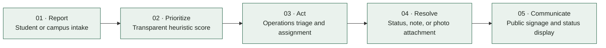

The workflow is implemented within a single browser application. It does not currently connect to a university maintenance backend or external dispatch service.

---

## 03. Three connected workspaces

| Workspace | Route | Purpose |
|---|---|---|
| Public landing page | `/` | Introduces CampusPulse and its workflow |
| Student & Campus Intake | `/#report` | Creates structured issue reports |
| Operations Command Hub | `/#operations` | Handles triage, status updates, and resolution records |
| Public Campus Signage | `/#kiosk` | Displays selected operational information in a 16:9 layout |

Start the application locally to access these routes.

### A. Student & Campus Intake

The reporting interface collects the information needed to describe and classify an issue.

**Implemented capabilities**

- Five issue categories: Energy, Water, Waste, Safety, and Facilities.
- Six predefined campus zones.
- Urgency selection: Low, Medium, High, and Emergency.
- Specific location, issue title, and description fields.
- Optional reporter name or handle.
- Field-level validation.
- An informational priority-score preview.
- A recent-report feed based on locally stored records.

The intake validation enforces:

| Field | Minimum requirement |
|---|---:|
| Title | 5 characters |
| Location | 3 characters |
| Description | 10 characters |

The reporter name is optional.

### B. Operations Command Hub

The operations workspace provides a local triage and resolution interface.

**Implemented capabilities**

- Active queue and resolution summary counters.
- Search by ticket number, title, description, or location.
- Filtering by status, category, and campus zone.
- Sorting by priority, newest, or oldest.
- Table and card-list presentation.
- Assignment labels for maintenance groups.
- Status updates.
- A resolution-recording dialog.
- Photo attachment with client-side image processing.
- Trust & Impact Ledger with resolution evidence categories.
- Local audit-history records.

The application supports these issue statuses:

`REPORTED` → `TRIAGED` → `IN_PROGRESS` → `RESOLVED`

Assignment labels are recorded locally. They do not dispatch work to an actual campus team or external maintenance system.

### C. Public Campus Signage

The signage workspace is designed for a large-format 16:9 screen.

**Implemented capabilities**

- Dark, high-contrast signage interface.
- Current date and time display.
- Public issue and resolution ticker.
- Active and resolved ticket presentation.
- Pause and resume controls for ticker animation.
- Fullscreen control.
- Six campus-zone status panels.
- Modelled environmental-estimate cards.
- Privacy-oriented data projection.

The QR graphic is illustrative, and its associated button simulates navigation to the reporting workspace. It is not a real QR-based mobile reporting integration.

The interface is browser-rendered. It does not integrate with BenQ X-Sign, a BenQ device-management service, or proprietary display hardware APIs.

---

## 04. Transparent priority calculation

CampusPulse uses a deterministic heuristic instead of claiming to use an opaque machine-learning model.

The score combines three components:

\[
\text{Score} =
\operatorname{clamp}_{1}^{100}
\left(
\operatorname{round}
(0.55U + 0.35C + 0.10A)
\right)
\]

Where:

- \(U\) = urgency score.
- \(C\) = category-impact score.
- \(A\) = unresolved-report age score.

### Urgency weights

| Urgency | Component score |
|---|---:|
| Emergency | 100 |
| High | 75 |
| Medium | 45 |
| Low | 20 |

### Category weights

| Category | Component score |
|---|---:|
| Safety | 95 |
| Energy | 80 |
| Water | 80 |
| Waste | 65 |
| Facilities | 50 |

The age component increases with unresolved-report age, up to its defined maximum.

### Priority tiers

| Final score | Priority tier |
|---:|---|
| 80–100 | Critical |
| 60–79 | High |
| 40–59 | Medium |
| 1–39 | Low |

**Important:** This is a prototype triage heuristic, not official institutional policy, an SLA calculation, or a validated safety-risk model. New reports are initially scored with zero unresolved hours; the saved score is not automatically recalculated as time passes.

---

## 05. Trust & Impact Ledger

CampusPulse keeps operational status separate from the documentation associated with a resolution.

It supports three evidence states:

| State | Meaning |
|---|---|
| `STATUS_RECORDED` | The ticket status was recorded without a qualifying resolution note or attachment. |
| `OPERATOR_DOCUMENTED` | A resolution note of at least 10 characters was recorded. |
| `EVIDENCE_ATTACHED` | A qualifying resolution note and supporting photo attachment are present in the record. |

These states describe what is stored in the application.

They do **not** establish authenticated technician identity, third-party inspection, independent verification, or proof that physical work was completed successfully.

### Attachment handling

The current client-side attachment policy supports:

- JPEG
- PNG
- WebP
- Maximum input size of 2 MB
- Extension, MIME-type, and image-signature checks
- SVG rejection
- Client-side image resizing and JPEG compression

Images are processed in the browser and saved as local data. When storage quota handling removes an attachment, the application is designed to downgrade its evidence state accordingly.

These are client-side safeguards, not comprehensive server-side upload security.

---

## 06. Environmental data: measured versus modelled

CampusPulse deliberately distinguishes unavailable physical measurements from illustrative estimates.

| Provenance | Meaning |
|---|---|
| `MEASURED` | A value obtained from an actual connected measurement source |
| `MODELLED` | An estimate derived from an explicit calculation or assumption |
| `NOT_MEASURED` | No physical measurement is available |

No live campus utility sub-meters, water-flow sensors, digital waste scales, or IoT telemetry feeds are connected to this prototype.

Consequently, direct measured totals are represented as `null` and displayed as unavailable rather than fabricated measurements.

The current application contains illustrative category-based environmental estimates. Their coefficients are prototype assumptions, not verified IIT Guwahati measurements or approved engineering standards.

**Do not use these estimates as actual campus energy savings, water conservation records, waste-diversion measurements, financial calculations, or sustainability-reporting evidence.**

---

## 07. Application architecture

CampusPulse currently uses a client-side architecture.

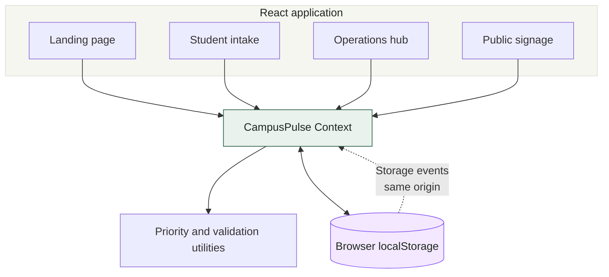

### Technology stack

| Layer | Technology |
|---|---|
| UI framework | React 19 |
| Language | TypeScript 5.7 |
| Build tool | Vite 6 |
| Styling | Tailwind CSS 3.4 |
| State management | React Context API |
| Persistence | Browser `localStorage` |
| Icons | Lucide React |
| CSS processing | PostCSS and Autoprefixer |

### Storage and synchronization boundaries

The application's records are stored in browser-local storage using the current issue key:

`campuspulse_issues_v4`

The code includes a browser-native `storage` event listener for same-origin state updates.

This mechanism is limited to compatible browser contexts sharing the same origin and storage area. It does not provide synchronization across devices, different browser profiles, or independent users.

The latest committed QA documentation marks live multi-process cross-tab acceptance as unverified in its test environment. Unit-level storage-event tests and React server-rendering checks should not be interpreted as proof of full browser E2E synchronization.

---

## 08. Privacy and data handling

The public signage component uses `sanitizeForPublicSignage` to create an allowlisted projection of issue records.

The projection excludes fields such as:

- Reporter name.
- Full issue description.
- Resolution notes.
- Audit-history records.
- Attachment payloads.

It retains selected operational fields, including:

- Ticket number.
- Title.
- Category.
- Location and campus zone.
- Status and evidence state.
- Priority score and tier.
- Report timestamp.

Because titles and locations are free-text fields, they may still contain information that should not be public.

**Avoid entering personal or sensitive information into report titles, locations, and other free-text fields.**

The application does not currently provide authenticated access, encrypted server-side storage, server-side access control, or a tamper-resistant audit service. Browser-local records may be inspected or modified by someone with access to that browser profile.

---

## 09. Visual gallery

The repository contains ten screenshot artifacts generated by the visual QA capture script. They are intended to show the application’s layout across the principal workspace states.

### Landing page and reporting

<p align="center">
  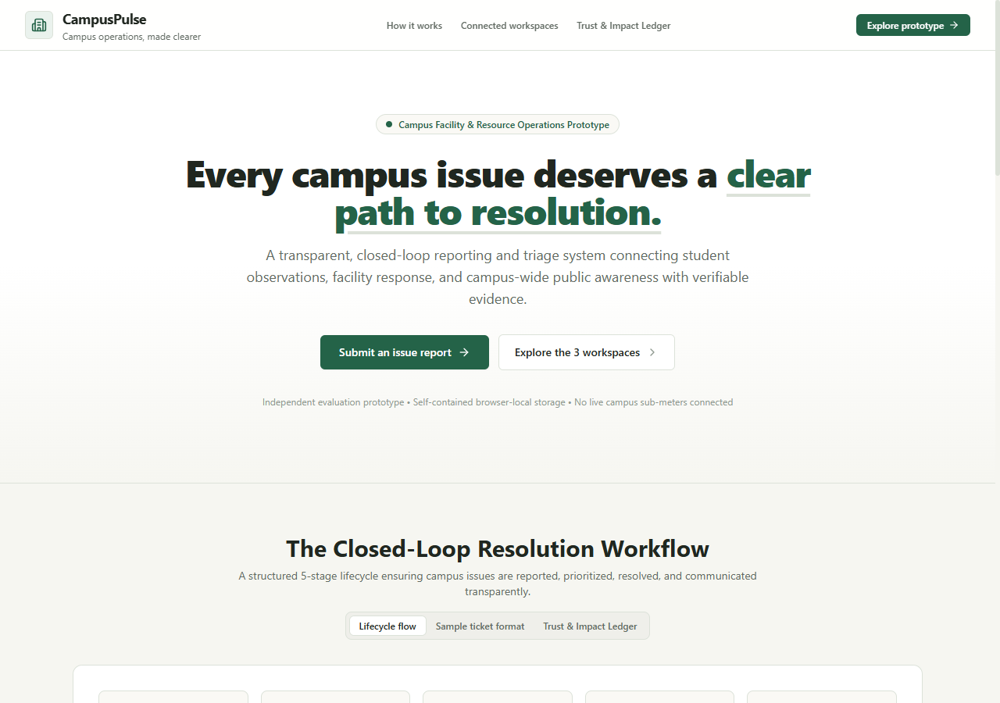
</p>

<p align="center">
  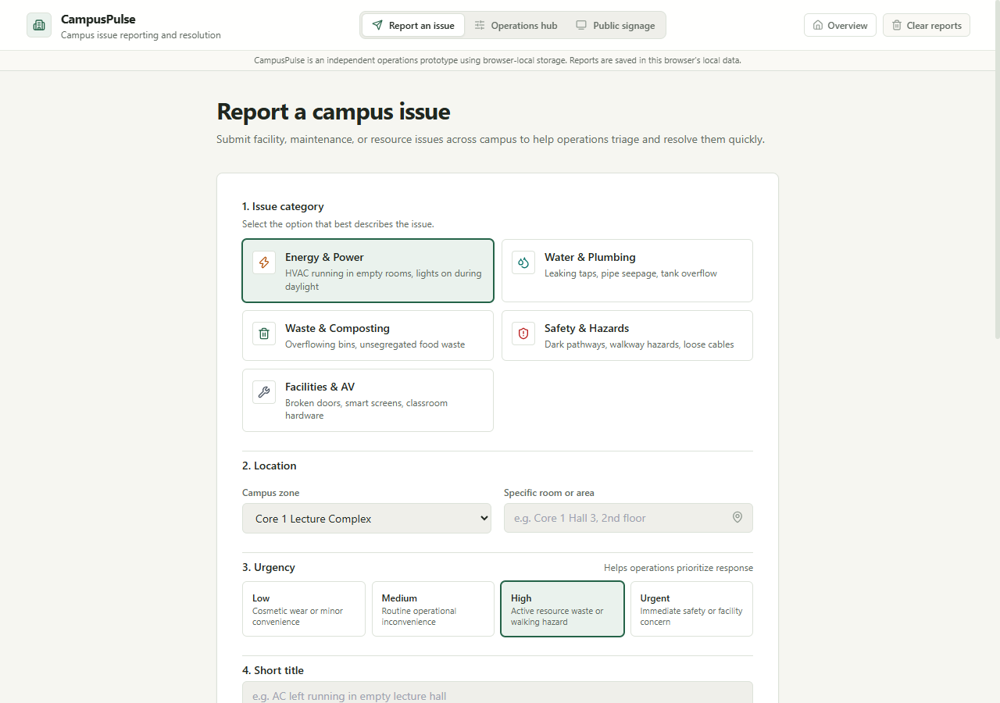
</p>

### Expand the full screenshot collection

<details>
<summary><strong>View all 10 acceptance screenshots</strong></summary>

**01 — Landing page, desktop**


**02 — Landing page, mobile**

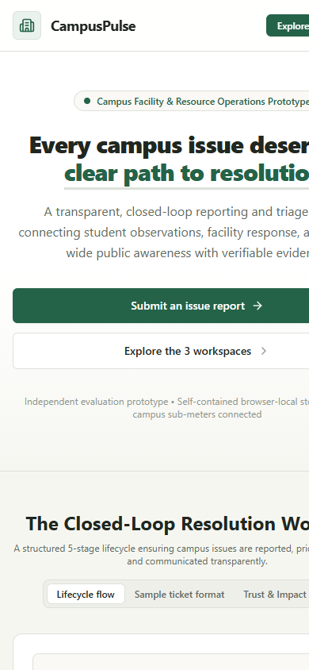

**03 — Student intake, desktop**


**04 — Student intake, mobile**

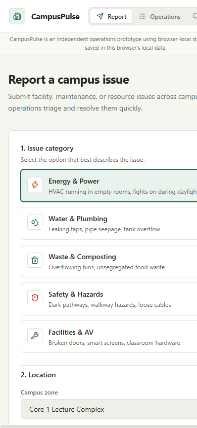

**05 — Student intake validation errors**

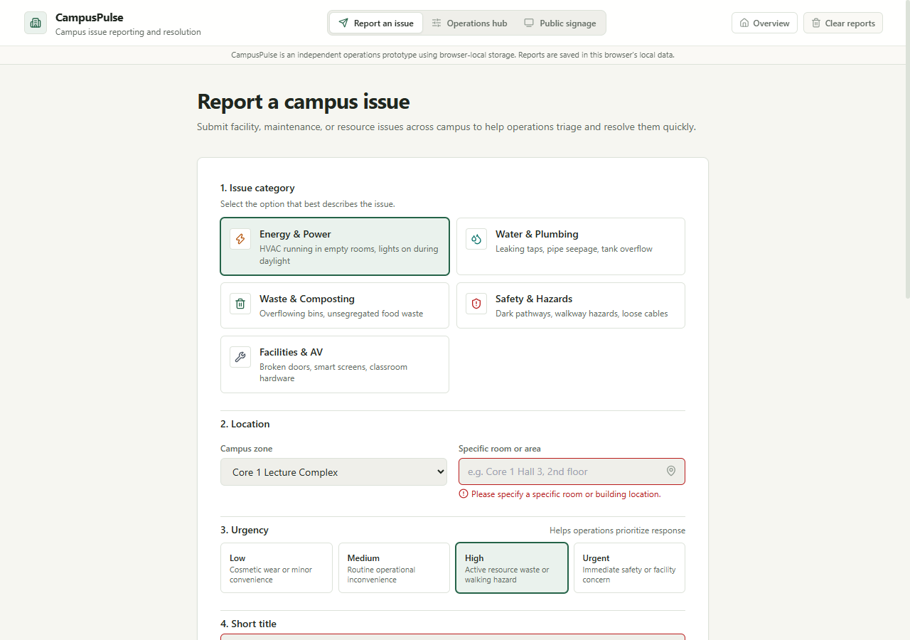

**06 — Operations hub, empty state**

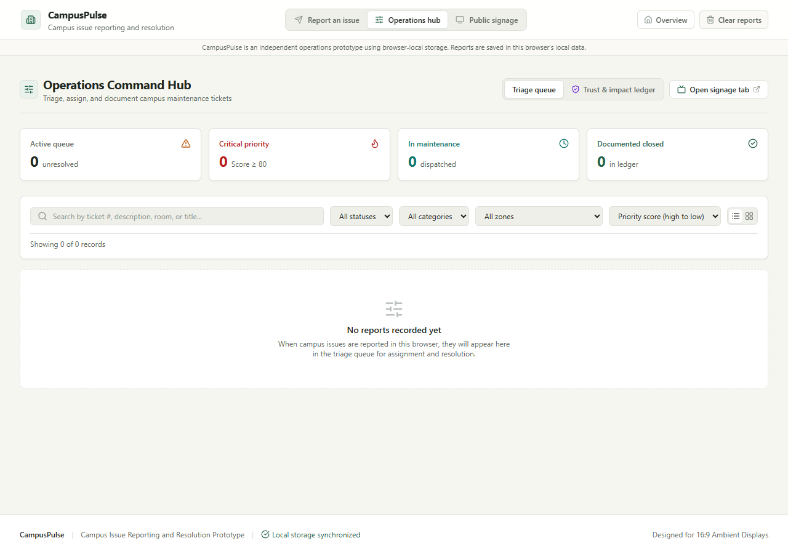

**07 — Operations hub, populated state**

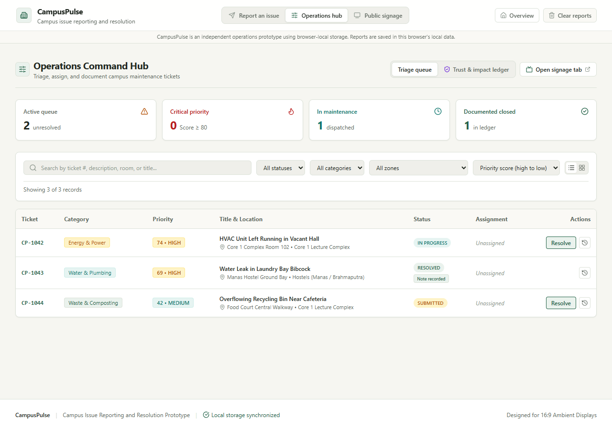

**08 — Operations Trust & Impact Ledger**

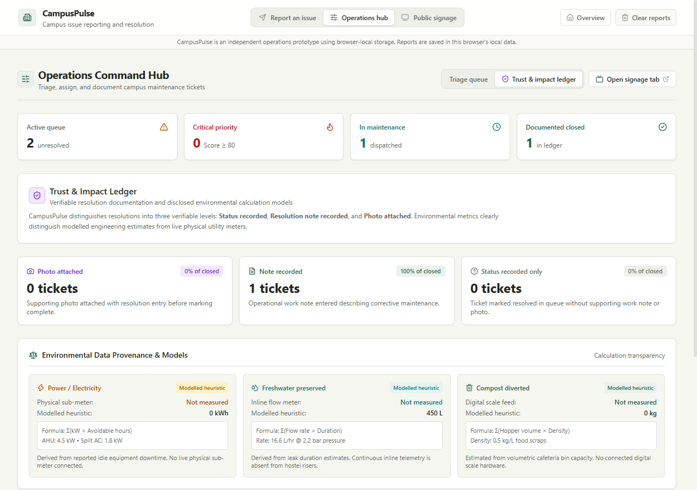

**09 — Public signage, empty state**

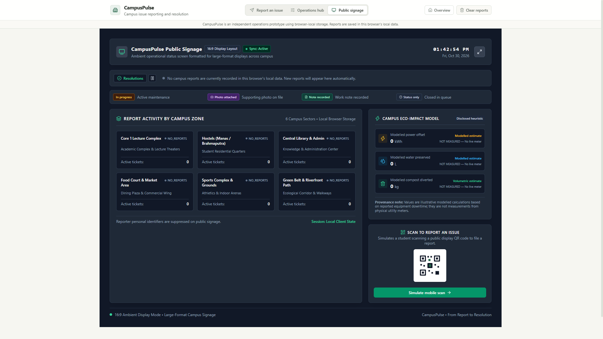

**10 — Public signage, populated state**

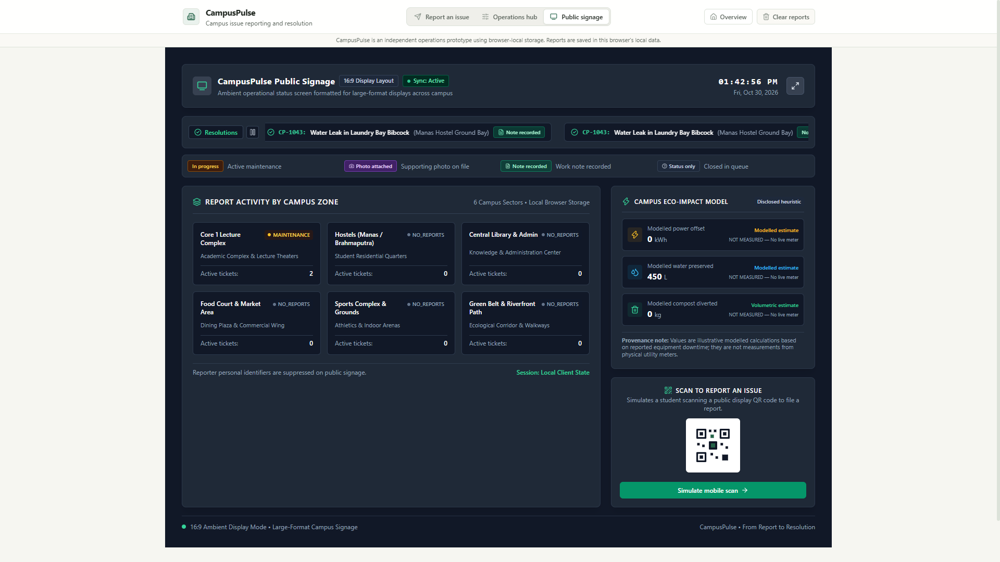

</details>

These are generated visual artifacts using synthetic test fixtures. Screenshot capture is not equivalent to live interaction testing or independent visual certification.

---

## 10. Getting started

### Prerequisites

- Node.js
- npm
- Git

### Clone the repository

```bash
git clone https://github.com/KartikeyG-world/CampusPulse.git
cd CampusPulse
```

### Install dependencies

Use the committed lockfile for a reproducible dependency installation:

```bash
npm ci
```

### Start the development server

```bash
npm run dev
```

Vite normally starts on:

```text
http://localhost:5173/
```

### Explore the application

| Workspace | Local URL |
|---|---|
| Landing page | `http://localhost:5173/` |
| Student intake | `http://localhost:5173/#report` |
| Operations hub | `http://localhost:5173/#operations` |
| Public signage | `http://localhost:5173/#kiosk` |

---

## 11. Testing and verification

The repository includes utility, data-integrity, React server-rendering, and visual-capture tooling.

### Available commands

| Command | Purpose |
|---|---|
| `npm test` | Bundles production modules, then executes the three automated test runners |
| `npm run test:components` | Executes React component and module SSR checks |
| `npm run build` | Runs TypeScript compilation and creates the Vite production bundle |
| `npm run preview` | Serves the production build locally |
| `npm run visual:qa` | Captures the ten configured visual states |

### What the test suites cover

| Test file | Main coverage |
|---|---|
| `tests/verify-user-journey.mjs` | Priority, validation, evidence transitions, attachment checks, storage-related logic and simulated event-handler scenarios |
| `tests/verify-landing-and-data-integrity.mjs` | Runtime source integrity, landing content, routing, migration, environmental metrics and privacy projection |
| `tests/verify-react-components.tsx` | React component markup rendered through `react-dom/server`, along with production-module checks |

The latest committed acceptance report records **194 passing assertions across these three suites**. Re-run the tests in your own environment to confirm the current result.

**Testing limitation:** React SSR tests validate generated markup, not real button clicks, live navigation, or complete browser workflows. The repository does not currently include a dedicated Playwright or Puppeteer E2E suite. Live multi-tab acceptance remains unverified.

### Visual QA requirements

Run the production build first:

```bash
npm run build
npm run visual:qa
```

The current screenshot script expects Google Chrome at this Windows path:

```text
C:\Program Files\Google\Chrome\Application\chrome.exe
```

The capture script uses temporary HTML harnesses and synthetic local-storage records to render the configured application states. Other operating systems or non-standard Chrome installations may require adapting that executable path.

---

## 12. Project structure

```text
CampusPulse/
│
├── artifacts/
│   └── acceptance/              # Ten generated PNG screenshots
│
├── src/
│   ├── components/
│   │   ├── BenQKioskView.tsx    # Public signage workspace
│   │   ├── Header.tsx           # Workspace navigation and local-data controls
│   │   ├── LandingPageView.tsx  # Public landing page
│   │   ├── OperationsView.tsx   # Triage and Trust & Impact Ledger
│   │   ├── StudentReportView.tsx# Student reporting form
│   │   ├── Toast.tsx             # Application notifications
│   │   └── PitchRunbookModal.tsx# Retained component; not mounted by App.tsx
│   │
│   ├── context/
│   │   └── CampusPulseContext.tsx
│   │
│   ├── data/
│   │   └── seedData.ts          # Empty initial runtime state
│   │
│   ├── types/
│   │   └── index.ts             # Domain and application types
│   │
│   ├── utils/
│   │   ├── priority.ts          # Priority heuristic
│   │   └── validation.ts        # Form, attachment and signage validation
│   │
│   ├── App.tsx
│   ├── main.tsx
│   └── index.css
│
├── tests/
│   ├── fixtures/
│   │   └── testSeedData.ts
│   ├── bundle-modules.mjs
│   ├── capture-visual-acceptance.mjs
│   ├── production-modules-entry.ts
│   ├── run-component-tests.mjs
│   ├── verify-landing-and-data-integrity.mjs
│   ├── verify-react-components.tsx
│   ├── verify-user-journey.mjs
│   └── verify-user-journey.ts  # Legacy file; not invoked by package scripts
│
├── ACCEPTANCE_VERIFICATION_REPORT.md
├── AGENTS.md
├── COMPETITIVE_ANALYSIS.md
├── PITCH.md
├── PRODUCTION_READINESS_AUDIT.md
├── QA_REPORT.md
├── README.md
├── requirements.md
├── rules.md
├── vision.md
├── UI_UX_REDESIGN_SPEC.md
├── UI_VISUAL_QA.md
│
├── package.json
├── package-lock.json
├── tsconfig.json
├── tsconfig.node.json
├── vite.config.ts
├── tailwind.config.js
└── postcss.config.js
```

---

## 13. Current scope and future requirements

CampusPulse is an interactive local prototype, not a deployed campus operations service.

| Capability | Current status |
|---|---|
| Student issue intake | Implemented |
| Priority heuristic | Implemented |
| Local operations queue | Implemented |
| Local assignment labels and status updates | Implemented |
| Resolution notes and photo attachments | Implemented |
| Trust & Impact Ledger presentation | Implemented |
| Public signage interface | Implemented |
| Browser-local persistence | Implemented |
| Same-origin storage-event handling | Implemented in code; live multi-tab acceptance unverified |
| Server-side authentication and authorization | Not implemented |
| Shared multi-user database | Not implemented |
| Cross-device synchronization | Not implemented |
| Real campus maintenance dispatch | Not implemented |
| Physical utility-meter integration | Not implemented |
| BenQ hardware or X-Sign integration | Not implemented |
| Tamper-resistant audit logging | Not implemented |

### Before a controlled campus pilot

The architecture would need, at minimum:

- A trusted backend API.
- Persistent shared database storage.
- Authentication and server-side role-based access control.
- Server-side validation and authorization.
- Centralized, safely managed attachment storage.
- Reliable concurrent-update handling.
- A trusted audit-history mechanism.
- Actual end-to-end browser verification.
- Verified environmental data sources where measured impact is claimed.

These are future engineering requirements, not features already supplied by the prototype.

---

## 14. Project documentation

The repository retains the original project and engineering material:

| Document | Purpose |
|---|---|
| [Project requirements](requirements.md) | Original product and challenge requirements |
| [Product vision](vision.md) | Product direction and intended experience |
| [Engineering rules](rules.md) | Evidence integrity and implementation standards |
| [Agent instructions](AGENTS.md) | Project-specific development directives |
| [Production-readiness audit](PRODUCTION_READINESS_AUDIT.md) | Architecture and maturity assessment |
| [Acceptance verification report](ACCEPTANCE_VERIFICATION_REPORT.md) | Recorded QA findings and test results |
| [Visual QA report](UI_VISUAL_QA.md) | Screenshot inventory and acceptance notes |
| [QA report](QA_REPORT.md) | Additional project verification record |
| [Competitive analysis](COMPETITIVE_ANALYSIS.md) | Challenge-era market and product research |
| [Pitch document](PITCH.md) | Original challenge presentation material |
| [UI/UX redesign specification](UI_UX_REDESIGN_SPEC.md) | Historical design direction |

Some documents preserve challenge-era assumptions and proposed future capabilities. Check the current source code before interpreting a documented requirement as an implemented feature.

---

## 15. Contribution guidelines

Contributions should preserve the project's evidence-first approach.

1. Create a focused feature or fix branch from `main`.
2. Keep each commit logically scoped and use clear Conventional Commit messages.
3. Avoid introducing external integrations or institutional claims without evidence.
4. Do not mix modelled estimates with measured values.
5. Keep test fixtures separate from runtime initial data.
6. Update relevant tests and documentation when behavior changes.
7. Run the available checks before opening a pull request.

Recommended local checks:

```bash
npm test
npm run build
git diff --check
```

The repository currently has no configured GitHub Actions workflow or protected-branch rules. These checks therefore need to be run by contributors; they are not currently enforced by repository CI.

---

## 16. License and usage

This repository currently does not contain a `LICENSE` file.

No open-source license is specified. Do not assume permission to reuse, redistribute, or modify the project until the repository owner adds an explicit license.

---

<div align="center">

### CampusPulse

**From Report to Resolution**

A more transparent way to represent the path from a campus observation to an operational record.

[Repository](https://github.com/KartikeyG-world/CampusPulse) · [Issues](https://github.com/KartikeyG-world/CampusPulse/issues) · [Pull requests](https://github.com/KartikeyG-world/CampusPulse/pulls)

</div>
## 🌟 Product Overview

Sprawling university campuses frequently face an **"Operational Black Hole"**:
1. **Reporting Friction:** When students or staff observe energy waste (e.g., HVAC left running in an empty lecture hall), water leaks, or pathway lighting faults, reports either never get submitted or disappear into an opaque administrative void.
2. **Prioritization Paralysis:** Operations and maintenance crews receive fragmented emails and phone calls without objective urgency scoring.
3. **Communication Blindspot:** The campus community never knows when an issue is acknowledged, leading to duplicate reports and user apathy.

**CampusPulse** closes this loop completely through a 5-stage lifecycle:
$$\textbf{Report} \longrightarrow \textbf{Prioritize} \longrightarrow \textbf{Act} \longrightarrow \textbf{Resolve} \longrightarrow \textbf{Communicate}$$

By connecting fast student reporting with a **transparent heuristic priority engine**, an audit-grade **Trust & Impact Ledger**, and **ambient public signage with real-time cross-tab synchronization** (designed for 16:9 large-format screens), CampusPulse turns passive bystanders into active campus stewards and celebrates institutional accountability.

---

## 🌐 Application Architecture & Four Connected Surfaces

CampusPulse is organized into a public product homepage and three synchronized operational workspaces:

### 0. 🏛️ Public Product Landing Page (Root Route `/`)
- **Product Overview & Mission:** Introduces the Report-to-Resolution mission, the 5-stage closed loop, and key operational capabilities.
- **Closed-Loop Workflow Preview:** Interactive conceptual preview illustrating how issues transition across the 5 stages from initial detection to verified resolution and ambient signage broadcast.
- **Feature Pillars:** Explains the 3-tier Resolution Evidence Ladder, the environmental provenance framework, and provides direct workspace launch actions.
- **Always Accessible:** Can be revisited at any time from any workspace by clicking the CampusPulse wordmark or the "Overview" button in the global header.

### 1. 📱 Student & Campus Reporting View (`/#report`)
- **Sub-45s Submission:** Clean category selector (Energy, Water, Waste, Safety, Facilities), campus zone picker, and location details.
- **Dynamic Heuristic Engine Preview:** Informational mathematical scoring (1–100) based on Urgency (55%), Category/Eco Impact (35%), and Unresolved-Report Age (10%).
- **Clean Baseline & Empty State:** Starts with a clean zero-seed baseline. When no reports are recorded, displays a clear informative empty state. Newly submitted reports appear immediately in the local feed.
- **Privacy First:** Student identities remain strictly in internal operational records and are never broadcast on public signage screens.

### 2. 🛠️ Operations Command Hub & Trust & Impact Ledger (`/#operations`)
- **Real-Time KPI Suite:** Total Active Tickets, Critical Priority count, In Progress count, and Documented Resolutions—derived dynamically from current records.
- **Multi-Filter & Search:** Filter by Status (`Reported`, `Triaged`, `In Progress`, `Resolved`), Category, Zone, or keyword with Table and Card view modes.
- **Trust & Impact Ledger:**
  - **Explicit Evidence States:** Resolving an issue categorizes it into:
    - `STATUS_RECORDED`: Status closed in queue without formal notes.
    - `OPERATOR_DOCUMENTED`: Technician work note ($\ge 10$ chars) recorded on file.
    - `EVIDENCE_ATTACHED`: Technician work-completion photo attached.
  - **Local Storage Quota Protection:** Uploaded images are validated (JPEG, PNG, WebP $\le 2$ MB) and downscaled client-side via an offscreen HTML canvas to max 600px JPEG (~25-40 KB), ensuring reliable persistence within browser storage quotas without blowing 5MB limits.
  - **Closed Incident Ledger Table:** Searchable audit table listing all closed tickets with their evidence level badge, technician notes, and an inline modal to inspect attached physical evidence.
  - **Environmental Provenance Transparency:** Explicitly classifies sustainability data as `MEASURED` (`NOT MEASURED — No live utility-meter data connected`, value: `null`), `MODELLED` (calculated from disclosed equipment power ratings and illustrative downtime constants), or `NOT_MEASURED` (unapplicable for civil hardware).
  - **Cross-Tab Launch Link:** "Open Signage Tab" (`#kiosk`) directly from the header for immediate multi-window demonstration.
- **Audit Trail:** Complete timestamped lifecycle history for every ticket.

### 3. 📺 Campus Signage Mode (`/#kiosk`, Designed for 16:9 Large Displays)
- **Ambient 16:9 Display:** High-contrast ambient layout formatted for 16:9 displays; hardware and proprietary signage platforms are not implemented.
- **Live Cross-Tab Synchronization:** Tab 1 (Operations) and Tab 2 (Public Signage) synchronize dynamically on the same origin via native browser `storage` events without page reloads or infinite write-back echo loops.
- **Evidence-Aware Resolution Marquee Ticker:** Continuously scrolls recently resolved tickets with standardized badges (`PHOTO ATTACHED`, `NOTE RECORDED`, `STATUS RECORDED`). Active items show `IN PROGRESS`. Personal identifiers and internal notes are completely suppressed for privacy.
- **Accessible Motion Controls:** Dedicated ticker Pause/Play control button and `@media (prefers-reduced-motion: reduce)` support in accordance with WCAG 2.2 Success Criterion 2.2.2.
- **Report Activity by Campus Zone:** Honestly reflects active report counts by campus sector, displaying `"No reports"` for sectors without active incidents (rejecting false claims of "Optimal" health without reports).
- **Eco-Impact Provenance Card:** Displays `NOT MEASURED` for live telemetry, and discloses illustrative formulas for modelled heuristics.

---

## 🎨 Warm, Editorial Campus Service UI/UX & Accessibility

The user interface adopts a **warm, editorial, human-centered campus service design**:
- **Design Tokens:** Warm off-white canvas (`#F6F6F1`), crisp white surfaces (`#FFFFFF`), hairline borders (`#DCE2D9`), deep ink typography (`#202720`), and forest green primary accents (`#246348`).
- **Single-Column Reporting Sequence:** Student Intake follows an intuitive single-column flow (Category $\to$ Zone $\to$ Location $\to$ Urgency $\to$ Title & Description $\to$ Optional Reporter Name $\to$ Submit).
- **Secondary Estimated Priority:** Algorithmic scoring remains deterministic and transparent under the hood, but is presented as an informational estimate with collapsible calculation details.
- **Zero-Seed Runtime Baseline:** A fresh installation initializes with an empty issue collection and zeroed metrics. Pre-existing legacy demonstration seed records are cleanly migrated and removed while preserving legitimate user records.
- **Deliberate Local Data Management:** A deliberate "Clear reports" modal allows users to safely clear browser-stored reports with an explicit confirmation step.
- **WCAG 2.2 AA Accessibility Compliance:**
  - **Modal Dialog Trapping:** Resolution, Assignment, and Confirmation modals implement focus trapping (Tab cycling), `Escape` key dismissal, and `role="dialog"`.
  - **Live Regions:** Dynamic priority calculation updates and toast notifications announce changes to assistive technologies (`role="status"`, `aria-live="polite"`).
  - **Accessible Names:** Icon buttons and filter inputs possess descriptive `aria-label` attributes.
  - **Motion Controls:** Marquee ticker animation respects user OS reduced-motion preferences (`prefers-reduced-motion: reduce`) and provides an inline pause/play toggle button.

---

## 🧪 Verification & Acceptance Tests

Our automated test suite exercises **112 test assertions** across two comprehensive test suites:

### Suite 1: Core Journey & Trust Ledger (`tests/verify-user-journey.mjs` — 67 Tests)
- Report creation and field validation (`VT-18`, `SEC10-12`).
- Deterministic priority scoring, tier boundaries, and edge cases (NaN/negative hours, unknown categories) (`VT-19`, `BEH-18`, `SEC10-13`).
- Resolution input validation: rejects missing/whitespace notes for documented resolutions, prevents `EVIDENCE_ATTACHED` without attachments (`BEH-01 .. BEH-06`).
- Full resolution evidence workflow (`STATUS_RECORDED`, `OPERATOR_DOCUMENTED`, `EVIDENCE_ATTACHED`) (`VT-01 .. VT-08`, `SEC10-05 .. SEC10-07`).
- Public display evidence-state segregation (`IN PROGRESS`, `PHOTO ATTACHED`, `RESOLUTION NOTE RECORDED`, `STATUS RECORDED`), ticker updates, and privacy filtering (`VT-09 .. VT-13`, `BEH-09 .. BEH-11`, `SEC10-08`).
- Disclosed environmental provenance and strict separation of unavailable measurements (`NOT_MEASURED`, null) from modelled metrics (`VT-14 .. VT-17`, `BEH-12 .. BEH-13`, `SEC10-01 .. SEC10-04`).
- Cross-tab synchronization via native browser storage events with loop breaking and safe handling of storage clear / malformed JSON (`BEH-14 .. BEH-16`, `SEC10-09 .. SEC10-11`).
- URL hash and query role routing (`#kiosk`, `#operations`, `#report`, `?role=kiosk`) (`BEH-17`).
- Sequential ticket identification and uniqueness (`VT-25`).

### Suite 2: Landing Page & Data Integrity (`tests/verify-landing-and-data-integrity.mjs` — 45 Tests)
- Runtime source files do not import seedData or test fixtures (`REQ16-01`).
- Clean zero-seed baseline export in static configuration (`REQ16-02`, `REQ16-03`).
- Absence of obsolete evaluator/competition copy from public landing page (`REQ02-01`).
- Main product headline, in-page section navigation, and workspace actions (`REQ04-01 .. REQ04-04`).
- Honest evidence terminology ("Photo attached", avoiding "Verified photo proof") (`REQ03-02`, `REQ03-03`).
- Absence of 1-click evaluation demo presets from StudentReportView (`REQ16-04`, `REQ16-05`).
- Truthful empty states in Student Intake, Operations Hub, and Public Signage (`REQ16-06`, `REQ16-07`, `REQ16-11`).
- Campus signage zone report status (rejection of false "Optimal" labels) (`REQ16-09`, `REQ16-10`).
- Deliberate local reports clearing action with confirmation modal (`REQ16-13`).
- Hash routing and in-page anchor conflict prevention (`ROUTING-01 .. ROUTING-08`).
- Targeted storage migration filtering known seed records while preserving user records (`MIGRATION-01 .. MIGRATION-03`).
- Dynamic eco-metrics computation derived strictly from resolved user issues (`METRICS-01`, `METRICS-02`).

```bash
# Run all automated test suites (112/112 passed)
npm test

# Build production bundle (TypeScript compile + Vite build)
npm run build
```

---

## 💻 Quick Start & Running Locally

```bash
# 1. Install dependencies
npm install

# 2. Run local development server
npm run dev

# 3. Open in browser:
# Root Landing Page:     http://localhost:5173/
# Student Intake View:   http://localhost:5173/#report
# Operations Command:    http://localhost:5173/#operations
# Public Campus Signage: http://localhost:5173/#kiosk

# To test live cross-tab synchronization:
# Window 1 (Operations Hub): http://localhost:5173/#operations
# Window 2 (Public Signage): http://localhost:5173/#kiosk
```

---

## 📚 Disclosures & Limitations

1. **Independent Evaluation Prototype:** CampusPulse is an independent prototype application. Demonstration records and reports created are stored strictly in the browser's local storage.
2. **No Hardware or Live System Integration:** No live utility sub-meters, physical IoT hardware, institutional databases, or native BenQ X-Sign systems are connected.
3. **Environmental Metrics Scope:** Modelled environmental figures (e.g. avoided power in kWh) are calculated using transparent downtime heuristics. Physical utility meter measurements display `NOT_MEASURED` (`null`) to preserve scientific integrity.
4. **Visual Acceptance Status:** Due to container GPU/display boundaries in headless Windows sandbox execution, raster pixel screenshot capture cannot be generated programmatically and is documented as `UNVERIFIED` in [UI_VISUAL_QA.md](./UI_VISUAL_QA.md). Evaluators are invited to review the rendered application live using `npm run dev`.
