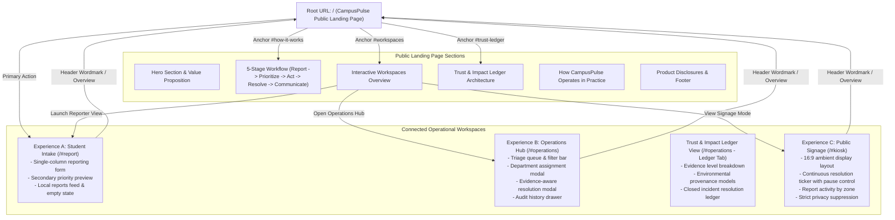

# CampusPulse: Complete Product Experience Redesign Specification
## Public Landing Page, Application UI, Design System & Information Architecture

**Document ID:** `UI_UX_REDESIGN_SPEC.md`
**Revision:** 4.0 (Post-Challenge Productization & Clean Data Architecture)
**Date:** October 29, 2026
**Target Application:** CampusPulse — From Report to Resolution

---

## 1. Product Design Principles

1. **Human-Centered & Warm Editorial Aesthetic:** CampusPulse rejects cold, cyberpunk, developer-terminal dashboards in favor of a warm, approachable, editorial campus service design. The interface uses warm neutrals (`#F6F6F1`), crisp white surfaces (`#FFFFFF`), deep neutral ink typography (`#202720`), and an authoritative forest green (`#246348`) primary action tone.
2. **Clear Public & Operational Separation:** The public landing page (`/`) serves first-time visitors and campus leadership by clearly framing the product's value proposition, connected loop, and evidence architecture. Operational workspaces (`#report`, `#operations`, `#kiosk`) serve focused tasks with appropriate density and context.
3. **Linear, Low-Friction Intake:** Student reporting follows a single-column, sequential flow (inspired by GOV.UK service design standards). Users complete reports in under 45 seconds without competing sidebars, confusing evaluation presets, or intimidating jargon.
4. **Honest Operational & Data Provenance:**
   - Visual states distinguish **Status recorded**, **Note recorded**, and **Photo attached**. An attached photograph is supporting visual documentation on file, not third-party engineering certification.
   - Sustainability metrics distinguish **Measured**, **Modelled heuristic estimates**, and **Not measured**. When physical sub-meters are absent, readings display `Not measured` (never a false zero).
5. **Truth in Affiliation & Baseline Integrity:** The product starts with a clean zero-seed baseline. No fabricated demonstration records or synthetic metrics are loaded by default. Reports entered in a browser remain local to that browser session.
6. **Universal Accessibility (WCAG 2.2 AA):** Strict adherence to contrast ratios ($\ge 4.5:1$ body, $\ge 3:1$ headings), visible focus rings, modal keyboard focus trapping, `Escape` key dismissal, ARIA live regions for dynamic calculations, accessible names for controls, and reduced-motion controls for animated tickers.

---

## 2. Target Audiences & Principal Tasks

| Audience Persona | Environment & Device | Principal Tasks | Success Metrics |
| :--- | :--- | :--- | :--- |
| **Campus Resident / Student** | Mobile smartphone (390px) or laptop | Report broken AC, leaking tap, or overflowing compost in < 45s; track issue status without account friction. | Sub-45s completion, zero field confusion, clear confirmation. |
| **Facility Operations Manager** | Desktop workstation (1280px+) | Triage queue, assign responsible wing, review priority scores, dispatch technicians, log resolution notes with photo evidence. | Fast filtering, zero dead buttons, clear audit trail. |
| **Campus Community Observer** | Wall-mounted 16:9 large display | Glance at sector report activity, recent resolutions, and sustainability models from 3–5 meters away. | High distance legibility, non-distracting ticker, strict privacy suppression. |
| **Campus Stakeholder / Evaluator** | Desktop or tablet browser at `/` | Understand the problem, see how the 5-stage loop functions, review the evidence model, and enter the prototype workspaces. | Clear mental model, intuitive navigation, transparent claims. |

---

## 3. Information Architecture & Routing

CampusPulse integrates a public product landing page with three dedicated operational workspaces using lightweight, reliable hash-based routing.

### 3.1 Information Architecture Diagram



---

## 4. Design System Tokens & Foundations

### 4.1 Color System

```css
:root {
  /* Canvas & Backgrounds */
  --color-canvas-default: #F6F6F1;
  --color-canvas-subtle:  #FAF9F5;
  --color-canvas-inset:   #EFEFEA;
  --color-surface-card:   #FFFFFF;

  /* Hairline Borders */
  --color-border-subtle:  #DCE2D9;
  --color-border-strong:  #BAC5B5;

  /* Typography */
  --color-text-primary:   #202720;
  --color-text-secondary: #626B63;
  --color-text-muted:     #8E988F;

  /* Brand Accents */
  --color-forest-primary: #246348;
  --color-forest-hover:   #1B4D37;
  --color-forest-soft:    #EAF2ED;
  --color-forest-ring:    rgba(36, 99, 72, 0.2);

  /* Status Tokens */
  --color-status-urgent-bg:     #FDF2F2;
  --color-status-urgent-text:   #A32D2D;
  --color-status-urgent-border: #F1C4C4;

  --color-status-medium-bg:     #FBF4E6;
  --color-status-medium-text:   #946800;
  --color-status-medium-border: #E8D8B0;

  --color-status-neutral-bg:    #EFEFEA;
  --color-status-neutral-text:  #626B63;
  --color-status-neutral-border:#DCE2D9;
}
```

### 4.2 Typography Hierarchy
- **Font Stack:** System Sans-Serif (`ui-sans-serif, system-ui, -apple-system, BlinkMacSystemFont, "Segoe UI", Roboto, "Helvetica Neue", Arial, sans-serif`).
- **Headings:** Bold to extrabold, proportional line height ($1.15$ to $1.25$).
- **Body Text:** Regular weight, line height $1.5$ to $1.6$, maximum line length $65$ch for long-form descriptions.
- **Monospace Code/Identifiers:** `ui-monospace, SFMono-Regular, Menlo, Monaco, Consolas, monospace` for ticket IDs (`#CP-1042`).

---

## 5. Screen Specifications & Post-Challenge Cleanup

### 5.1 Public Landing Page (`/`)
- **Restrained Header:** Wordmark `CampusPulse`, product descriptor *"Campus operations, made clearer"*, anchor navigation (`#how-it-works`, `#workspaces`, `#trust-ledger`), and CTA `Explore prototype`.
- **Hero Section:** Value proposition headline *"Every campus issue deserves a clear path to resolution"*, primary action `Submit an issue report`, secondary action `Explore the 3 workspaces`, and prototype disclosure.
- **Removed Obsolete Content:** Zero competition badges, no evaluator runbook banners, no pitch controls, no hardcoded live statistics pills, and no repetitive feature cards.
- **Illustrative Closed-Loop Flow:** 5 sequential cards (Report, Prioritize, Act, Resolve, Communicate) and illustrative ticket anatomy.

### 5.2 Student Intake View (`/#report`)
- **Single-Column Sequence:** Category radio cards $\to$ Zone selector $\to$ Location $\to$ Urgency radio cards $\to$ Title & Description $\to$ Optional Reporter Name $\to$ Submit Button.
- **Removed Elements:** All 1-click evaluation demo presets (`Auditorium AC`, `Laundry tap leak`, etc.) removed from the runtime form.
- **Empty State:** When no issues exist in local storage, renders a clean informative message: *"No reports recorded yet. Reports submitted through this form will appear here and synchronize to the Operations Hub."*

### 5.3 Operations Command Hub (`/#operations`)
- **Dual View Modes:** Tabular Data Grid and Card List layouts.
- **Dynamic KPI Strip:** Derived strictly from the current `issues` collection: Total Active, Critical Priority, In Progress, and Documented Closures.
- **Deliberate Clear Action:** Deliberate confirmation modal to clear locally saved reports.
- **Trust & Impact Ledger:**
  - 3-tier Evidence breakdown: Photo attached, Note recorded, Status recorded only.
  - Environmental Provenance: Sub-meters display `NOT MEASURED` (`null`), and modelled metrics derive dynamically from user-created resolved issues.

### 5.4 Campus Public Signage (`/#kiosk`)
- **16:9 Display Design:** High contrast ambient dark theme (`#111827`).
- **Marquee Ticker:** Continuously scrolling resolved/active reports with WCAG pause/play controls. Empty state displays truthful message when 0 reports exist.
- **Zone Report Status:** Zones with 0 issues display `"No reports"` (neutral gray), preventing false claims of "Optimal" health without reports.
- **Strict Privacy:** Complete suppression of student identities and unrestricted internal notes.
