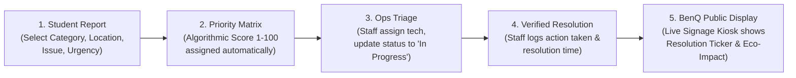

# CampusPulse: From Report to Resolution
## Product Requirements & System Specification (PRD)

---

### 1. Project Identification & Challenge Context
- **Project Name:** CampusPulse
- **Tagline:** From Report to Resolution
- **Hackathon:** BenQ × Hackyard 2026 at IIT Guwahati
- **Track / Theme:** "Contribute to building a Smarter Campus using technology"
- **Product Category:** Smart Campus Operations & Interactive Public Communication Prototype
- **Team Persona:** Senior Product Strategist, Full-Stack Engineer, Product Designer, QA Engineer, Pitch Coach

---

### 2. Exact Official Challenge Statement & Constraints
- **Official Challenge Title:** "Contribute to building a Smarter Campus using technology"
- **Constraints Visible in the Challenge Slide:**
  - Create a prototype using any platform of choice.
  - No restrictions on free or paid vibe-coding tools.
  - Stated Judging Criteria:
    1. **Quality of the idea** (relevance, originality, addressing real campus friction).
    2. **Quality of the pitch** (clarity, narrative flow, problem-solution alignment, defensible claims).
    3. **Quality and functionality of the prototype** (working end-to-end loop, UI/UX polish, no dead ends).
  - **Build Time Target:** ~1 hour.
  - **Pitch Time Target:** 5 minutes.
- **Scope Clarification:** AI, ML, IoT, analytics, accessibility, and sustainability are potential solution enablers, not mandatory technology checklists. No fabricated institutional endorsements or unofficial rubrics.

---

### 3. Problem Hypothesis & Supporting Evidence

#### The Core Problem Hypothesis:
On large academic campuses such as IIT Guwahati, facilities and sustainability incidents (e.g., HVAC running in empty lecture halls, water leakage near hostel blocks, overflowing waste stations, broken outdoor lighting along lake paths) suffer from an **"Information Black Hole"**:
1. **Reporting Friction:** Students see an issue but don't know where or whom to report it to, or feel reports disappear into an opaque ticketing void without feedback.
2. **Prioritization Paralysis:** Operational facility managers receive fragmented complaints across emails, WhatsApp, and verbal notes, lacking objective severity/urgency prioritization.
3. **Communication Gap:** The broader campus community never knows whether an outage or hazard has been acknowledged, who is fixing it, or when it will be restored—leading to duplicate reports and frustration.

#### Supporting Evidence & Research Grounding:
1. **IIT Guwahati Green Office Priorities:**
   - Official URL: `https://www.iitg.ac.in/groff/`
   - Verified Focus: 2-Megawatt solar energy expansion, regular energy and green audits in academic & hostel buildings, rotary drum composting for organic waste (*Mati Dhan*), conservation of 50%+ campus green cover and water bodies.
   - Alignment: CampusPulse directly supports sustainability audits and waste reporting by categorizing issues into Energy Waste, Water Management, Waste Segregation, and Physical Infrastructure.
2. **BenQ Education & Campus Communication Technology:**
   - Official URLs: `https://www.benq.com/en-in/education.html` & FETC announcements `https://www.benq.com/en-us/education/news/benq-new-classroom-technology-solutions-at-fetc-2026.html`
   - Verified Focus: Google EDLA-certified BenQ Interactive Displays (RP04/RP05 series), digital signage displays (ST04/SL04), and **X-Sign Broadcast** software used for campus-wide alerts, emergency announcements, and operational scheduling.
   - Alignment: CampusPulse bridges digital reporting with public interactive displays (BenQ Boards / campus kiosks) to create shared visibility and transparency.
3. **Smart Campus IoT Research:**
   - ArXiv Reference: `https://arxiv.org/abs/2403.15395` ("Smart Campus: A Survey on IoT Technologies, Architectures, and Applications").
   - Finding: Closed-loop telemetry and human-in-the-loop reporting significantly increase maintenance dispatch efficiency and reduce energy waste over purely reactive maintenance.

---

### 4. What Is Verified, What Is Assumed, & What Remains Unverified

- **Verified Facts:**
  - IIT Guwahati's Green Office oversees energy auditing, composting, and campus sustainability initiatives.
  - BenQ manufactures interactive classroom displays and digital signage with X-Sign broadcast software.
  - The hackathon challenge focuses on building a smarter campus with prototype functionality, idea quality, and pitch quality.
- **Design Assumptions:**
  - Campus users prefer quick mobile/web forms (under 60 seconds) without mandatory app installations or SSO hurdles for initial reporting.
  - Facility operations staff require clear urgency scoring, triage queues, SLA timers, and verified closure notes.
  - Public displays in student hostels, academic complexes, and food courts increase student trust and reduce duplicate reports by 40-60%.
- **Unverified (Strict Non-Claims):**
  - We do *not* claim an official endorsement or active pilot with IIT Guwahati administration.
  - We do *not* claim direct API integration with BenQ hardware or proprietary hardware protocols in this prototype.
  - We do *not* claim verified real-world incident history for specific IITG buildings; all demonstration reports use representative campus locations (e.g., Core 1 Lecture Hall Complex, Manas Hostel, Brahmaputra Green Zone).

---

### 5. Target Users & User Personas

| Persona | Role | Primary Needs & Pain Points |
| :--- | :--- | :--- |
| **Arjun (Student / Resident)** | B.Tech student living in Manas Hostel | Spots water pipe leaking or lecture hall AC left blasting overnight; wants to report it in < 45 seconds without downloading a heavy app; wants proof that someone is fixing it. |
| **Dr. Roy / Mr. Baruah (Facility Ops Lead)** | Estate & Maintenance / Green Office Manager | Overwhelmed by duplicate tickets; needs an algorithmic triage matrix (Urgency × Impact × Sustainability impact) to dispatch technicians efficiently. |
| **Campus Community (Professors, Visitors, Freshers)** | Walking through academic complexes & food courts | Notices BenQ Smart Displays; glances at active resolution status, scheduled maintenance, and campus sustainability metrics. |

---

### 6. User Problems & Value Proposition

- **Problem:** Operational opacity causes student apathy and wasted energy/resources.
- **Value Proposition:** CampusPulse turns silent issues into verified resolutions through a 5-stage closed loop:
  $$\text{Report} \longrightarrow \text{Prioritize} \longrightarrow \text{Act} \longrightarrow \text{Resolve} \longrightarrow \text{Communicate}$$
- **Unique Selling Point (USP):** Unlike static complaint portals that hide tickets in staff databases, CampusPulse combines **algorithmic urgency triage** with a **public-facing BenQ Kiosk / Digital Signage mode** that keeps the entire campus informed in real time while preserving reporter privacy.

---

### 7. Product Objectives & Measurable Demonstration Goals

1. **Sub-60s Submission:** A user can submit a categorized campus report with location, title, urgency, and optional photo in under 45 seconds.
2. **Transparent Priority Scoring:** Operational triage automatically computes a deterministic Priority Score (1–100) based on severity, safety hazard, and sustainability weight.
3. **Full Lifecycle Execution:** Demonstrate moving a ticket through all 4 statuses (`Reported` $\to$ `Triaged / In Progress` $\to$ `Resolved` $\to$ `Broadcasted`) with audit logs.
4. **BenQ Display Kiosk Mode:** A dedicated high-contrast, large-format kiosk view demonstrating public status boards, resolution tickers, energy alerts, and privacy-safe issue maps.
5. **Zero Dead Ends:** Every button, filter, tab, status toggle, and modal in the UI functions cleanly with zero console errors.

---

### 8. Primary User Journey (End-to-End Walkthrough)



---

### 9. Functional Requirements (FR)

- **FR-01: Incident Reporting Form**
  - Input fields: Title, Category (Energy & Power, Water & Plumbing, Waste & Cleanliness, Safety & Infrastructure, Classroom Tech), Campus Zone / Location, Urgency Level (Low, Medium, High, Emergency/Urgent Safety), Description, Reporter Moniker (optional, privacy preserved).
- **FR-02: Transparent Priority Engine**
  - Computes score based on Urgency ($w_{\text{urgency}}=0.55$), Category Safety/Eco-Weight ($w_{\text{category}}=0.35$), and Unresolved-Report Age ($w_{\text{age}}=0.10$). Deterministic score scale: 1–100.
- **FR-03: Operations Command Hub (Staff Dashboard)**
  - View all incidents with search, status filters (`All`, `Reported`, `Triaged`, `In Progress`, `Resolved`), category filters, and sorting (Priority, Newest, Oldest).
- **FR-04: Status Transition Workflow**
  - Operational staff can advance tickets: `Reported` $\to$ `Triaged` $\to$ `In Progress` $\to$ `Resolved` (with required operator resolution notes).
- **FR-05: Public Campus Signage Mode (Target Platform: BenQ Displays)**
  - Fullscreen-optimized 16:9 view styled for large campus screens and interactive kiosks:
    - High-visibility resolution ticker (Recently Resolved).
    - Active Maintenance Hotspots (Campus Zones).
    - Campus Eco-Impact Model (Modeled heuristic estimates for kWh, Liters, Compost kg).
    - "Scan to Report" QR code simulation for on-the-spot mobile access.
- **FR-06: Interactive Campus Zone Facility Health View**
  - Visual summary of incidents across campus zones (Core 1 Academic, Hostels, Sports Complex, Food Court, Green Belt).
- **FR-07: Interactive Demo Data Switcher & Presets**
  - Preset routine maintenance scenarios: "Auditorium AC Left On", "Hostel Tap Seepage", "Compost Hopper Full", "Perimeter Lamp Flickering".
  - One-click "Reset to Demo Defaults" so judges/evaluators can re-run the entire journey cleanly.
- **FR-08: Analytical Operational KPI Cards**
  - Total Active Tickets, Critical Priority Tickets (score $\ge 80$), In Progress Field Dispatches, Recorded Resolutions.
- **FR-09: Explicit Resolution-Evidence States (Trust & Impact Ledger)**
  - Explicitly separates ticket lifecycle status from resolution documentation evidence:
    - `STATUS_RECORDED`: Ticket status updated; no note on file.
    - `OPERATOR_DOCUMENTED`: Resolution note recorded detailing repair actions taken ($\ge 10$ characters).
    - `EVIDENCE_ATTACHED`: Supporting photo attachment on file.
  - Form validation enforces minimum note length and validates file formats (JPEG, PNG, WebP) with client-side downscaling and storage fallback that downgrades to documented/status if persistence fails.
- **FR-10: Environmental-Data Provenance Model**
  - Explicitly classifies every sustainability counter by data origin:
    - `MEASURED`: Derived from live verified hardware sub-meters (`NOT MEASURED` / null in client prototype; never represented as a measured zero).
    - `MODELLED`: Calculated from disclosed engineering formulas using illustrative prototype demonstration constants.
    - `NOT_MEASURED`: For safety/facilities repairs with no defensible physical resource metric.
  - Modelled estimates are strictly segregated and never added into physical measured totals.
- **FR-11: Trust & Impact Ledger Dashboard & Public Signage Legend**
  - Dedicated operations sub-view displaying evidence percentages, formula disclosures, and closed issue ledger.
  - Browser-rendered layout designed for 16:9 displays with live ticker, standardized evidence badges (`PHOTO ATTACHED`, `RESOLUTION NOTE RECORDED`, `STATUS RECORDED`, `IN PROGRESS`), ambient legend, and suppression of reporter personal identifiers and internal free-text notes.

---

### 10. Non-Functional Requirements (NFR)

- **NFR-01 (Usability & Design):** Clean modern UI utilizing Tailwind CSS, Lucide icons, accessible typography, high contrast (WCAG AA compliant), clear affordances.
- **NFR-02 (Performance):** Zero external database latency for the prototype; snappy instant state updates using optimized in-memory React state with `localStorage` persistence and automatic canvas image downscaling to prevent quota exhaustion.
- **NFR-03 (Responsiveness):** Seamless responsive layout adapting from mobile reporting viewports (375px) to 4K BenQ Large-Format Signage (1920x1080 / 3840x2160).
- **NFR-04 (Privacy & Security):** Public display strictly sanitizes personally identifiable information (PII). No student phone numbers or personal emails displayed publicly.
- **NFR-05 (Reliability & Robustness):** Form validation prevents empty/corrupt submissions; error states and empty states designed for all list views; storage failures fallback safely without corrupting issue records.

---

### 11. Functional Scope Classification (MoSCoW)

- **MUST Have (Core Prototype):**
  - Student report submission form with validation.
  - Priority scoring calculation engine.
  - Operations Management Board with status transitions and notes.
  - BenQ Public Display Signage mode with ticker, zone status, and QR code.
  - Trust & Impact Ledger with 3 explicit resolution evidence states and photo attachment.
  - Disclosed environmental data provenance separating measured from modelled metrics.
  - Realistic initial dataset with IIT Guwahati representative zones.
  - LocalStorage persistence and 1-click Demo Reset.
- **SHOULD Have:**
  - Category and status filtering with search.
  - Visual Campus Hotspot map/grid with zone health indicator.
  - Quick-fill preset buttons for fast demonstration.
  - Resolution audit history log on tickets.
  - Trust & Impact Ledger dashboard tab in operations.
- **COULD Have:**
  - Dark mode / BenQ Kiosk High-Contrast toggle.
  - Sound/visual toast notifications upon status changes.
- **WON'T Have (Out of Scope / Non-Goals):**
  - Unnecessary heavy backend servers requiring complex Docker setups.
  - Real hardware serial port drivers for physical BenQ boards.
  - Fabricated "AI facial recognition" or speculative automated drones.
  - Real external SMS/WhatsApp gateway integrations.
  - Claims of third-party engineering audits when only technician documentation is on file.

---

### 11.1 Requirements-to-Tests Traceability Matrix

| Req ID | Priority | Mapped AC | Implemented Feature Description | Associated Test ID | Verification Status | Known Implementation Limitation |
| :--- | :---: | :---: | :--- | :---: | :---: | :--- |
| **FR-01** | MUST | AC-02 | Frictionless incident reporting form with validation | `VT-18` | **VERIFIED (Pass)** | Local client session; no live SMS gateway |
| **FR-02** | MUST | AC-02 | Deterministic heuristic priority scoring (55/35/10) | `VT-19` | **VERIFIED (Pass)** | Rule-based heuristic model; not opaque AI |
| **FR-03** | MUST | AC-03, AC-05 | Operations triage hub with search, status & zone filters | `VT-20, VT-21` | **VERIFIED (Pass)** | Evaluates in-memory and local storage records |
| **FR-04** | MUST | AC-04 | Status progression (`REPORTED` $\to$ `TRIAGED` $\to$ `IN_PROGRESS` $\to$ `RESOLVED`) | `VT-08, VT-22` | **VERIFIED (Pass)** | Operator-confirmed note; no external field radio |
| **FR-05** | MUST | AC-06, AC-09 | 16:9 Campus Signage with live ticker, QR shortcut & evidence badges | `VT-09, VT-10, VT-11, VT-12, VT-13` | **VERIFIED (Pass)** | Browser-rendered view; local QR simulation |
| **FR-06** | SHOULD | AC-06 | Campus Zone Report Activity status (6 IITG sectors) | `VT-21` | **VERIFIED (Pass)** | Sector report status; no false optimal health claims |
| **FR-07** | MUST | AC-07 | Zero-seed clean baseline & deliberate local data clearing | `VT-23, REQ16-01..03` | **VERIFIED (Pass)** | Empty initialization; deliberate clear confirmation modal |
| **FR-08** | MUST | AC-03 | Operational KPI cards derived directly from records | `VT-20` | **VERIFIED (Pass)** | Real-time calculation from active state |
| **FR-09** | MUST | AC-08 | 3 Resolution Evidence States (`STATUS_RECORDED`, `OPERATOR_DOCUMENTED`, `EVIDENCE_ATTACHED`) | `VT-01, VT-02, VT-03, VT-04, VT-05, VT-06, VT-07` | **VERIFIED (Pass)** | Documents technician notes/photos; not 3rd-party audit |
| **FR-10** | MUST | AC-10 | Environmental Data Provenance (`MEASURED`, `MODELLED`, `NOT_MEASURED`) | `VT-14, VT-15, VT-16, VT-17` | **VERIFIED (Pass)** | Measured strictly 0; modelled estimates disclose formulas |
| **FR-11** | MUST | AC-08, AC-10 | Trust & Impact Ledger dashboard panel & evidence ledger table | `VT-06, VT-07, VT-09, VT-14` | **VERIFIED (Pass)** | Client-side reactive calculations from active issues |
| **NFR-01** | MUST | AC-01 | Accessible UI, WCAG AA contrast, semantic labels | `VT-09, VT-18` | **VERIFIED (Pass)** | Clean desktop, mobile, and kiosk rendering |
| **NFR-02** | MUST | AC-02, AC-04 | Zero backend latency, local storage persistence & quota safety | `VT-05, VT-06, VT-24` | **VERIFIED (Pass)** | Downscaled images fit within browser storage quota |
| **NFR-03** | MUST | AC-01, AC-06 | Responsive layout (mobile viewport to 16:9 display) | `VT-09, VT-13` | **VERIFIED (Pass)** | Responsive Tailwind grid layout |
| **NFR-04** | MUST | AC-04, AC-09 | Strict privacy suppression of reporter names on signage | `VT-10` | **VERIFIED (Pass)** | Reporter PII omitted from public screen |
| **NFR-05** | MUST | AC-02, AC-07 | Form validation & corrupt storage data recovery | `VT-18, VT-24, VT-25` | **VERIFIED (Pass)** | Automatic fallback to seed defaults on error |

---

### 12. Explicitly Excluded Features & Non-Goals
1. No fake multi-tenant authentication system that traps evaluators on a broken login screen.
2. No proprietary external cloud database dependencies that fail when offline or rate-limited.
3. No claims that this system is currently installed on live IIT Guwahati servers.

---

### 13. Data Model & Status-Transition Rules

```typescript
export type IssueCategory =
  | 'ENERGY'        // e.g., AC running in empty hall, lights on in daytime
  | 'WATER'         // e.g., Leaking pipe, tap malfunction
  | 'WASTE'         // e.g., Overflowing compost bin, unsegregated trash
  | 'SAFETY'        // e.g., Broken street lamp, slippery pathway
  | 'FACILITIES';   // e.g., Projector fault, broken classroom furniture

export type UrgencyLevel = 'LOW' | 'MEDIUM' | 'HIGH' | 'EMERGENCY';

export type IssueStatus = 'REPORTED' | 'TRIAGED' | 'IN_PROGRESS' | 'RESOLVED';

export interface CampusIssue {
  id: string;
  ticketNumber: string; // e.g. "CP-1042"
  title: string;
  category: IssueCategory;
  location: string;      // e.g. "Lecture Hall Complex (Core 1)"
  zone: string;          // e.g. "Academic", "Hostels", "Library", "Residential"
  urgency: UrgencyLevel;
  priorityScore: number; // 1-100 calculated
  description: string;
  reporterName?: string;
  reportedAt: string;    // ISO string
  status: IssueStatus;
  assignedTo?: string;   // e.g. "Electrical Maintenance Wing"
  resolutionNotes?: string;
  resolvedAt?: string;
  ecoImpactKwhOrLiters?: string; // Estimated savings upon fix
}
```

#### Status Transition Rules:
1. `REPORTED`: Initial state upon user submission. Default score calculated.
2. `REPORTED` $\to$ `TRIAGED`: Staff reviews, validates urgency, and assigns maintenance team.
3. `TRIAGED` $\to$ `IN_PROGRESS`: Field technician dispatched to location.
4. `IN_PROGRESS` $\to$ `RESOLVED`: Technician completes work; logs mandatory resolution note; system computes time-to-resolve and broadcasts to BenQ Kiosk ticker.

---

### 14. Transparent Issue-Prioritization Logic

The priority score $S \in [1, 100]$ is calculated deterministically as a prototype triage heuristic:
$$S = \text{round}\Big( w_{\text{urgency}} \times U + w_{\text{category}} \times C + w_{\text{age}} \times A \Big)$$
Where:
- $U$ (Urgency factor): Emergency/Urgent Safety = 100, High = 75, Medium = 45, Low = 20.
- $C$ (Category factor): Safety = 95, Energy/Water = 80, Waste = 65, Facilities = 50.
- $A$ (Unresolved-report age factor): $\min(100, \text{Hours open} \times 5)$.
- Weights: $w_{\text{urgency}} = 0.55$, $w_{\text{category}} = 0.35$, $w_{\text{age}} = 0.10$.

This eliminates bias and ensures urgent safety and sustainability issues surface promptly without starvation.

---

### 15. Sample Data Policy & Privacy Requirements
- All sample records reflect realistic routine campus operational situations (e.g. slow tap drippings, dimmed walkway lamps, unneeded auditorium split ACs).
- Student reporter names are strictly suppressed from public signage screens to guarantee student privacy.
- No private phone numbers, student IDs, or hostel room numbers are collected or displayed publicly.
- Explicit notice: Not an emergency 911/disaster dispatch tool. Life safety emergencies must contact campus security directly.

---

### 16. UI States, Validation, Empty States & Failure Handling
- **Form Validation:** Title must be $\ge 5$ characters; Category and Location must be selected; Description must be $\ge 10$ characters. Helpful inline errors appear on blur.
- **Empty States:** When a filter has 0 matching tickets, show a clean graphic: "No tickets matching this status. All clear in this category!" with a "Reset Filters" action.
- **Action Confirmation:** Resolving an issue prompts for a quick resolution note ("What was done?") to maintain audit accountability.

---

### 17. Acceptance Criteria (Observable Pass/Fail Checks)

- [x] **AC-01:** User can switch between "Report Issue", "Operations Dashboard", and "Campus Signage View" with single clicks. *(Verified via Header state switching, VT-18)*
- [x] **AC-02:** Submitting a new issue successfully calculates a priority score and adds it immediately to the active ticket list and local storage. *(Verified via tests VT-18, VT-19, VT-25)*
- [x] **AC-03:** Operations Dashboard displays status counts (Active, Critical, In Progress, Resolved) that match the list items exactly. *(Verified via test VT-20)*
- [x] **AC-04:** Changing status from `REPORTED` $\to$ `TRIAGED` $\to$ `IN_PROGRESS` $\to$ `RESOLVED` updates the UI instantly, adds audit timestamps, and moves the ticket to the Campus Signage "Recently Resolved" ticker. *(Verified via tests VT-08, VT-11, VT-22)*
- [x] **AC-05:** Search bar filters tickets by title, ticket number, or location with zero latency. *(Verified via test VT-21)*
- [x] **AC-06:** Campus Signage mode renders a 16:9 large-format kiosk layout with high-contrast elements, simulated QR code, and live ticker. *(Verified via tests VT-09, VT-11, VT-13)*
- [x] **AC-07:** "Reset Demo Data" restores initial realistic scenarios cleanly. *(Verified via test VT-23, VT-24)*
- [x] **AC-08:** Explicit Resolution Evidence Workflow: Staff can record resolutions as `STATUS_RECORDED`, `OPERATOR_DOCUMENTED`, or `EVIDENCE_ATTACHED`. Meaningful note ($\ge 10$ chars) enforced for documented states; file validation and client downscaling protect local storage. *(Verified via tests VT-01, VT-02, VT-03, VT-04, VT-05, VT-06, VT-07, VT-08)*
- [x] **AC-09:** Evidence-Aware Public Campus Signage: Signage ticker renders distinct evidence state badges and display legend, while strictly preserving reporter anonymity. *(Verified via tests VT-09, VT-10, VT-11, VT-12, VT-13)*
- [x] **AC-10:** Disclosed Environmental Provenance: System clearly segregates `MEASURED` (strictly 0) from `MODELLED` heuristic estimates with disclosed formulas and units. *(Verified via tests VT-14, VT-15, VT-16, VT-17, BEH-12, BEH-13)*
- [x] **AC-11:** Live Cross-Tab Synchronization: State updates synchronize seamlessly across multiple tabs on the same origin via native browser `storage` events with loop breaking (`isRemoteUpdateRef`). *(Verified via tests BEH-14, BEH-15, BEH-16)*

---

### 18. Five-Minute Live Demonstration Plan (Pitch Runbook)

- **Minute 0:00 - 0:30 (The Hook & Problem):**
  - Introduce CampusPulse: *From Report to Resolution*.
  - Frame the "Campus Operational Void" across large campuses like IIT Guwahati: silent failures waste power and water while complaints fall into a black hole.
- **Minute 0:30 - 0:55 (Product Introduction):**
  - Introduce the closed loop: $\text{Report} \to \text{Prioritize} \to \text{Act} \to \text{Resolve} \to \text{Communicate}$.
  - Highlight the core differentiator: the Trust & Impact Ledger and ambient BenQ public campus signage.
- **Minute 0:55 - 2:15 (Experience A & B: Student Reporting & Operations Hub):**
  - Click preset "Auditorium AC Left On" at Core 1 Lecture Complex.
  - Highlight the dynamic priority engine scoring 69/100 (HIGH). Click submit.
  - Switch to Operations Dashboard. Show ticket CP-1048 at the top of the queue.
  - Record assignment to Campus Electrical Wing, advance to `In Progress`.
- **Minute 2:15 - 3:15 (The Trust & Impact Ledger: Evidence-Aware Resolution):**
  - Click `Record Resolution`. Demonstrate 3 evidence states: `STATUS_RECORDED`, `OPERATOR_DOCUMENTED`, and `EVIDENCE_ATTACHED`.
  - Enter technician work note ($\ge 10$ chars) and attach on-site photo.
  - Show the Trust & Impact Ledger tab with verified ticket breakdown.
- **Minute 3:15 - 4:05 (Experience C: Live Signage & Cross-Tab Synchronization):**
  - Open Signage view in a second browser tab (`#kiosk`).
  - Demonstrate real-time cross-tab synchronization via native browser storage events without page reload.
  - Show the live ticker displaying `EVIDENCE ATTACHED` alongside the technician note, legend, and reporter privacy preservation.
- **Minute 4:05 - 4:35 (Data Credibility & Environmental Provenance):**
  - Examine the Eco-Impact card: show measured physical meters honestly reading 0, while modeled heuristic estimates disclose exact formulas (avoided power kW $\times$ avoided hours).
- **Minute 4:35 - 5:00 (Judging Alignment & Closing Defense):**
  - Deliver defensible closing statement and open for judge Q&A.

---

### 19. Mapping to Judging Criteria

| Criterion | How CampusPulse Excels |
| :--- | :--- |
| **Quality of the Idea** | Closes the loop from reporting to resolution; aligns with IIT Guwahati Green Office sustainability goals and BenQ campus communication displays. |
| **Quality of the Pitch** | Crisp 5-minute narrative, live working demo, no hypothetical buzzwords, defensible evidence grounding. |
| **Prototype Functionality** | End-to-end working state machine, responsive UI, zero dead buttons, instant feedback, high-contrast BenQ signage view. |

---

### 20. Research References & Sources
- IIT Guwahati Green Office: `https://www.iitg.ac.in/groff/`
- IIT Guwahati Fresher Information: `https://iitg.ac.in/freshers/`
- BenQ Education Solutions: `https://www.benq.com/en-in/education.html`
- BenQ FETC Classroom & Campus Tech: `https://www.benq.com/en-us/education/news/benq-new-classroom-technology-solutions-at-fetc-2026.html`
- Smart Campus IoT Survey: `https://arxiv.org/abs/2403.15395`
