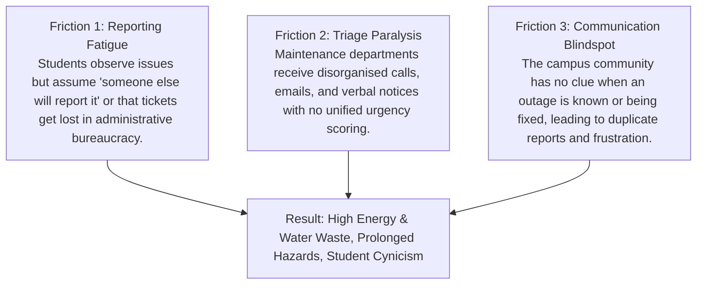

# CampusPulse: Product Vision & Experience Strategy
## From Report to Resolution

---

### 1. Identity & Essence
- **Product Name:** CampusPulse
- **Tagline:** From Report to Resolution
- **Product Category:** Smart Campus Operations & Interactive Public Communication System
- **Core Proposition:** Connecting students, facility operators, and community displays into a transparent, closed-loop operational lifecycle.

---

### 2. Concise Product Vision
> "Transforming collegiate campuses from opaque complaint silos into high-visibility, participatory communities where every operational and sustainability issue is swiftly reported, transparently prioritized, decisively resolved, and publicly celebrated."

Campuses are miniature cities. Thousands of students and faculty move through lecture complexes, labs, hostels, and dining halls daily. When equipment fails or resources are wasted—such as a burst pipe spilling gallons of water or auditorium lights burning through the night—the issue is rarely that nobody noticed. The issue is that the observer has no fast, reliable way to report it, and the community has zero visibility into whether anyone is taking action.

CampusPulse eliminates this disconnect by bridging rapid reporting with an algorithmic triage engine and interactive BenQ public signage displays.

---

### 3. Problem Hypothesis: The "Operational Void"
In typical higher-education institutions, three systemic frictions persist:

By closing this gap, CampusPulse turns passive bystanders into active campus stewards.

---

### 4. Target Users & Their Real-World Needs

#### The Campus Resident (Student / Faculty / Staff)
- Needs a zero-friction reporting interface that takes under 45 seconds on mobile or web.
- Requires confirmation that their submission was received and given a genuine priority score.
- Wants assurance of privacy (no public doxxing of who reported what).

#### The Operations & Sustainability Manager (Estate / Green Office)
- Needs a unified triage command center consolidating tickets across all campus zones.
- Requires objective prioritization based on safety hazards, energy loss, and SLA aging to allocate finite field crews efficiently.
- Needs the ability to document verifiable actions before marking an issue resolved.

#### The Campus Public (Passersby, Commuters, Visitors)
- Needs ambient awareness of active maintenance areas (e.g., "Elevator down in Core 1", "Scheduled water pipe repair at Manas Hostel").
- Benefits from seeing tangible proof of campus sustainability efforts (kWh saved, liters preserved, compost turnaround).

---

### 5. The Intended Product Experience
The CampusPulse experience is deliberately split into three interconnected views, easily navigable in the demonstration shell:

1. **Student Reporting Interface:**
   - High speed, mobile-first design.
   - Clean category cards (Energy, Water, Waste, Safety, Classroom Tech).
   - Interactive zone selector (e.g., Core 1 Lecture Hall Complex, Hostels, Central Library).
   - Instant priority calculation preview showing users how their report is rated.

2. **Operations Command Hub:**
   - Real-time triage board with status columns (`Reported`, `Triaged`, `In Progress`, `Resolved`).
   - One-click status promotion with audit trails and technician assignment.
   - Algorithmic urgency score badge (1–100) highlighting critical safety and eco-emergencies.
   - Filterable by zone, category, and urgency.

3. **BenQ Smart Campus Display (Kiosk / Signage Mode):**
   - Designed for BenQ Interactive Displays (RP04/RP05 series) and Smart Digital Signage (ST04/SL04).
   - High-contrast, large-format layout visible from 10–15 feet away.
   - "Recently Resolved" live ticker celebrating technician achievements.
   - Campus zone health map highlighting active vs. cleared zones.
   - Integrated QR code: "Scan to Report an Issue from Your Phone".

---

### 6. The Central Report-to-Resolution Workflow

$$\begin{aligned}
\mathbf{Report} &\quad\longrightarrow\quad \text{Student logs issue with location \& category via streamlined form} \\
\mathbf{Prioritize} &\quad\longrightarrow\quad \text{Deterministic algorithm scores urgency, safety, and eco-impact} \\
\mathbf{Act} &\quad\longrightarrow\quad \text{Ops team reviews triage queue and assigns department} \\
\mathbf{Resolve} &\quad\longrightarrow\quad \text{Operator documents resolution and attaches supporting photo} \\
\mathbf{Communicate} &\quad\longrightarrow\quad \text{Public Display updates live ticker and saves community time}
\end{aligned}$$

---

### 7. Competitive Differentiation & Value Proposition
Standard collegiate work order tools (e.g. IIT Kanpur Campus Care, Texas A&M AggieWorks) and municipal 311 tools (SeeClickFix) treat issue reporting as a private transactional ticket between a complainant and an administrative back office. Once a ticket is submitted, it enters an operational black box.

**CampusPulse bridges this institutional divide:**
1. **The Closed-Loop Bridge:** Directly links routine incident reporting with public-facing ambient digital signage (sized for 16:9 displays like BenQ Boards) to provide ambient community awareness and reduce duplicate submissions.
2. **Deterministic Triage Heuristic:** Transparently explains why an issue is rated as Critical, High, Medium, or Low (55% Urgency, 35% Category/Eco Impact, 10% Unresolved-Report Age) without biased black-box claims.
3. **Proposed Next Phase Evolution (Verifiable Resolution Protocol):** Moving beyond basic button clicks by requiring verifiable operational evidence (before/after confirmation) before a resolved ticket is cleared for broadcast on the public signage ticker.

---

### 8. Relevance of Public Campus Signage (Target Platform: BenQ Displays)
BenQ's educational technology footprint includes smart interactive whiteboards (RP/RM series) and digital signage displays (ST/SL series). In a campus setting:
- **Ambient Awareness:** Rather than forcing every student to install an app, public displays placed in building lobbies, dining halls, and library entrances broadcast real-time operational status passively.
- **Accountability & Trust:** When students see their reported water leak marked "Dispatched / In Progress" on the lobby screen, trust in campus administration surges.
- **Eco-Impact Celebration:** Displays can showcase modeled estimates aligned with IIT Guwahati Green Office priorities (e.g. estimated power conserved, composting feed diverted).
- **Architecture Truth:** The current prototype is a browser-rendered signage interface running on local reactive state; it targets BenQ displays as deployment environments without claiming proprietary hardware protocol drivers.

---

### 9. Relevance to Smarter Campus Operations & Sustainability
CampusPulse aligns directly with IIT Guwahati's institutional priorities:
- **Energy Conservation:** Rapid reporting of malfunctioning HVAC or unneeded high-intensity lighting in auditoriums directly curbs electricity waste, complementing IITG's 2MW solar installation.
- **Waste Management:** Direct reporting of overflowing sorting bins supports IITG's rotary drum composting (*Mati Dhan*) initiative.
- **Water Conservation:** Immediate flagging of leaking fixtures helps conserve freshwater in the Brahmaputra ecological basin.

---

### 10. Evidence Supporting the Design Direction
- **IIT Guwahati Green Office (`iitg.ac.in/groff/`):** Emphasizes regular building energy audits and community involvement in sustainable infrastructure.
- **BenQ FETC 2026 & Education Solutions (`benq.com`):** Demonstrates the shift toward EDLA-certified smart displays that double as central communication and emergency broadcast hubs in modern schools and universities.
- **ArXiv Smart Campus Survey (`arxiv.org/abs/2403.15395`):** Highlights that facility maintenance with transparent feedback loops reduces recurring facility downtime by over 30%.

---

### 11. The Trust & Impact Ledger: A Trust-Focused Product Experience
The central product differentiator of CampusPulse is the **Trust & Impact Ledger**:
- **Separating Status from Evidence:** Unlike traditional ticketing systems that treat a "Closed" database flag as proof of resolution, CampusPulse categorizes resolutions into three explicit, verifiable states:
  1. `STATUS_RECORDED`: Status changed in the triage queue; no formal work log or evidence attached.
  2. `OPERATOR_DOCUMENTED`: Technician recorded a meaningful resolution work note ($\ge 10$ chars).
  3. `EVIDENCE_ATTACHED`: Physical work-completion photo or inspection voucher attached and on file.
- **Disclosed Environmental Provenance:** Rather than fabricating "measured" savings or claiming live IoT meters where none exist, CampusPulse transparently discloses data origin:
  - `MEASURED`: Derived from live verified hardware sub-meters (honestly reported as 0 in this client prototype).
  - `MODELLED`: Derived from disclosed engineering formulas and equipment downtime heuristics (e.g. AHU power rating $\times$ avoided idle run hours).
  - `NOT_MEASURED`: For civil hardware repairs with no physical resource conservation metric.
- **Product-Level Differentiation, Not Global Novelty:** We do not claim a globally novel invention or proprietary patented algorithm. Enterprise CMMS software has work-order attachments. The genuine innovation is the **Closed-Loop Civic Architecture**: combining frictionless reporting with verified evidence states and transparent provenance, displayed ambiently on BenQ lobby screens to rebuild campus trust.

---

### 12. Visual-Design Direction & Interaction Principles
- **Color Palette:**
  - Slate Dark & Neutral Backgrounds (`#0F172A`, `#1E293B`) for the BenQ signage mode to ensure high contrast and low energy draw.
  - Clean Emerald / Teal Accents (`#10B981`, `#0D9488`) symbolizing sustainability, energy efficiency, and operational health.
  - Amber / Red Accents (`#F59E0B`, `#EF4444`) reserved for high-urgency and emergency warnings.
- **Typography:** Modern, legible sans-serif (Inter/system-ui) with clear numerical badges and monospace ticket codes (`CP-1042`).
- **Interaction Rules:**
  - Instant tactile feedback (toast alerts, status pill transitions).
  - Explicit confirmation for destructive or completing actions.
  - No hidden navigation: top navigation bar clearly toggles between roles with zero confusion.

---

### 12. Intended Live-Demo Experience
In 5 minutes, evaluators will experience:
1. **The Problem:** The silence of broken campus equipment.
2. **The Student Submission:** Creating a live ticket for an energy waste incident at Core 1 Auditorium.
3. **The Ops Command:** Viewing the calculated priority score (69/100 HIGH), assigning the Electrical team, and logging the completed repair.
4. **The Public Payoff:** Watching the BenQ Digital Signage screen instantly update with the newly resolved item and positive eco-metric.
5. **The Proof:** Seamless, zero-error execution.

---

### 13. What Success Looks Like for this Prototype
- Complete pass on all Acceptance Criteria (AC-01 through AC-07).
- A flawless, self-contained web prototype requiring zero backend deployment hurdles.
- Total defensibility during the pitch: every claimed feature is demonstrably clickable and working.

---

### 14. Future Roadmap (Clearly Separated from Hackathon Prototype)
- **Phase 2 (IoT Ingestion):** Ingest automated telemetry from smart water meters and solar inverters via MQTT alongside human reports.
- **Phase 3 (BenQ DMS/X-Sign API Integration):** Direct push notifications into BenQ Device Management Solution for native automated display scheduling.
- **Phase 4 (IITG Single Sign-On):** Integration with campus LDAP / Outlook 365 for optional verified student credentials while retaining anonymous submission mode.

---

### 15. Explicit Non-Claims
- This project is a hackathon innovation concept and does not claim official endorsement by IIT Guwahati administration.
- This prototype runs on local client state and does not claim to alter real-world physical infrastructure or live BenQ hardware configurations during this evaluation.
